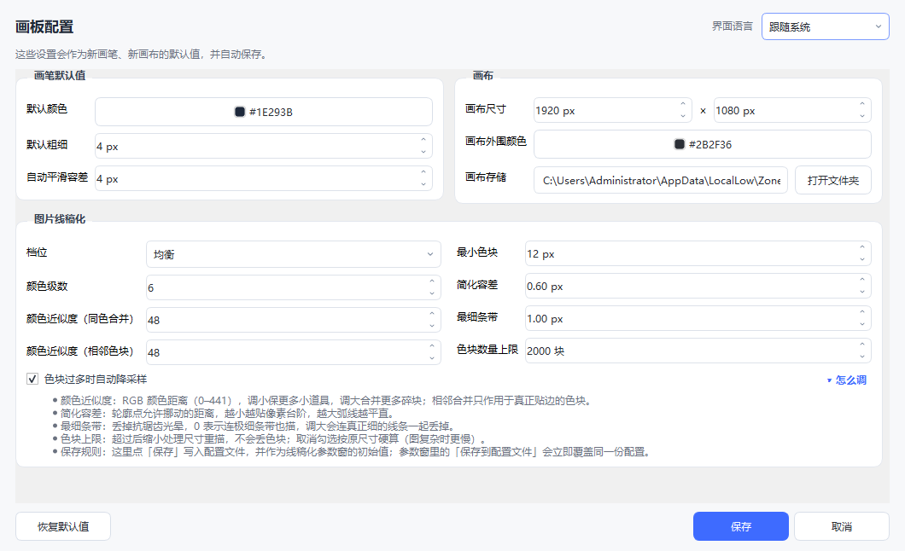

# StoryBoard 故事板

使用 **Qt 6 / C++17 / CMake** 编写的轻量故事板应用。一张画布由多个图层组成，图层里放曲线、直线、图片、文字和图形；画布保存为 UTF-8 JSON（`.sbcanvas`），可继续编辑，也可导出 PNG / JPEG / PDF。


## 功能

每条只写重点与入口，快捷键统一放在「快捷键」一节，不再重复。

- **画布与图层**：背景固定为第 0 层，用户图层可新建、删除空图层、重命名、显隐、锁定、上移 / 下移。同层 `height` 唯一且越大越靠上，入口是图层树卡或右键菜单。画布默认 1536×1024（24×16 格，每格 64 px），四边四角可拖拽拉伸或裁剪。
- **四种模式**：查看 / 编辑 / 画笔 / 文字，入口是右上「视图模式」卡或视图菜单。查看只改视图，编辑负责选择、移动、缩放、旋转与框选，画笔按描线颜色 / 宽度 / 样式画曲线，文字在画布上插入文字。滚轮以光标为中心缩放，空格或中键拖动平移。
- **常见图形**：顶部工具栏与插入菜单都提供 18 种图形，按棋盘格 2 格 = 128 px 为基准边长插入。椭圆系、扇形与弧线可改长 / 短半轴，扇形与弧线另可改起始角、扫过角，平行四边形可调内角；正弦波形只描线、不填充，也不参与合并。

  

- **曲线类预设**：直线、直线箭头、左右花括号、弧线、正弦波与图形同在一个插入菜单里。花括号本质是曲线（右括号即左括号旋转 180°），可移动、缩放、改描线样式。
- **编辑面板**：默认停靠画布左侧；单选时按行给填充、描线、透明度、圆角、角度与半轴，多选时给对齐与合并，末尾是图层 ±1 与层内高度 ±1。无图元选中时隐藏全部图元编辑项，填充与描线控件保留可用，作为插入图形的默认样式。面板宽度按内容算定（260–320 px），可在 260–360 px 之间拖拽调整。
- **属性编辑**：入口是编辑面板（`Alt+2`）；每行对应一个属性，图标后的控件按类型给出输入框、按钮等编辑器，仅编辑模式可编辑。名称、图层、层内高度、填充、描边、位置尺寸、旋转、圆角、文字与图片内容都可改。
- **全屏**：`F11` 进入 / 退出，收起菜单栏、状态栏、主工具栏与模式卡，只留画布与顶部悬浮工具栏；工具栏按 `0`–`9` 依次是椭圆、直线、直线箭头、三角形、圆角矩形、五角星、菱形、心形、左括号与自定义图形，其后是填充 / 描线样式与描线宽度。全屏里编辑面板改成左侧悬浮并在无选中时收起，图层面板落右下角并压矮，退出后恢复原来的停靠与尺寸；模式键位与常用快捷键照常可用。
- **分组与层级**：同层多选后组合，拖动任一成员整组移动，分组可嵌套。单击组内图元选中整棵组树，双击则只单选被点中的成员。
- **对齐与合并**：2 个以上图元可在「编辑 → 对齐」或编辑面板做六向对齐，3 个以上加水平 / 垂直等间距。合并图元分联合、组合、拆分、相交、剪除五项，命名与图标参照 PPT「合并形状」，结果替换原图元并只占一条撤销记录。
- **自定义图形**：把 `.sbcanvas` 放进配置目录的 `shapes` 子目录，应用自动扫描并追加到「常见图形 → 自定义图形」。模板只取矢量轮廓，忽略图片与文字；删除模板不影响已插入的画布。
- **画布文件与导出**：文件菜单直接列出画布目录下的 `.sbcanvas`，默认在用户配置目录的 `canvases`。导出支持画布区域或全部图元、PNG / JPEG / PDF、0.25×–4×，可整张导出或按可见图层分别导出，不包含网格、棋盘格与手柄。

  

- **图片线稿化**：文件菜单的「导入图片线稿化」按颜色切块后逐块描成折线，整体只占一条撤销记录。参数与「设置 → 图片线稿化」共用一套值，档位与细项见「命令行」一节。
- **撤销 / 重做**：图元增删、移动缩放旋转、分组 / 解组、文字与图片编辑、样式修改、背景替换、画布尺寸、图层增删排序都进入撤销栈，上限 300 步。
- **设置**：设置对话框集中管理画笔默认值、画布尺寸与外围颜色、线稿化档位与细项；「保存」写入 `StoryBoard.ini`。

  

- **界面语言**：简体中文 / English，可跟随系统，切换后立即生效；`STORYBOARD_LANG=zh|en` 可临时覆盖。

## 快捷键

应用内「帮助 → 快捷键一览…」（`F1`）按菜单分组实时列出所有绑定并允许改键，冲突时提示占用者。这里只列常用项与本项目自创的组合；自创键位取自英文词义（image / insert、Lineart），与模式键同族的加 `Shift` 以避开文字加粗。

| 类别 | 操作 | 快捷键 |
| --- | --- | --- |
| 文件 | 新建 / 打开 / 保存 / 另存为 | `Ctrl+N` / `Ctrl+O` / `Ctrl+S` / `Ctrl+Shift+S` |
| 文件 | 插入图片 / 导入图片线稿化 / 导出 | `Ctrl+I` / `Ctrl+L` / `Ctrl+E` |
| 模式 | 查看 / 编辑 / 画笔 / 文字 | `H` / `V` / `B` / `T` |
| 视图 | 全景 / 放大 / 缩小 / 实际大小 | `Ctrl+0` / `Ctrl+=`（副 `Ctrl++`） / `Ctrl+-` / `Ctrl+1` |
| 视图 | 辅助网格 | `Ctrl+'` |
| 视图 | 图层面板 / 图元编辑面板 | `Alt+1` / `Alt+2` |
| 编辑 | 撤销 / 重做 | `Ctrl+Z` / `Ctrl+Y`（副 `Ctrl+Shift+Z`） |
| 编辑 | 复制 / 粘贴 / 副本 | `Ctrl+C` / `Ctrl+V` / `Ctrl+D` |
| 编辑 | 组合 / 取消组合 | `Ctrl+G` / `Ctrl+Shift+G` |
| 编辑 | 简化选中曲线 | `Ctrl+Shift+B` |
| 编辑 | 顺 / 逆时针旋转 45° | `Ctrl+R` / `Ctrl+Shift+R` |
| 编辑 | 调整层内高度（仅编辑模式） | `]` / `[` |
| 编辑 | 方向键微调（仅编辑模式） | `←` `→` `↑` `↓`，按住 `Shift` 单次 10 px |
| 其他 | 平移 / 取消 | 长按 `Space` 或中键拖动；`Esc` 取消笔画或清除选中 |

## 命令行

无参数启动进入图形界面；位置参数里第一个存在的 `.sbcanvas` 启动后直接打开：

```bash
StoryBoard.exe examples/demo-canvas.sbcanvas
```

### 图片线稿化

`--lineart 图片.png --lineart-out 输出.sbcanvas`：按当前档位把图片转成曲线画布，默认均衡档、1 px 最细条带、线宽固定 1（折线，不做平滑），长边超过 11800 px 时等比缩小，输出画布四周留 20 px 边距，失败打印原因并返回非 0。参数语义与「设置 → 图片线稿化」一致，档位 0–3 对应保留细节 / 均衡（默认）/ 线条干净 / 大块概括：

| 档位 | 颜色级数 | 同色合并 | 相邻合并 | 最小色块 | 简化容差 |
| --- | --- | --- | --- | --- | --- |
| 保留细节 | 6 | 40 | 44 | 8 px | 0.5 px |
| 均衡（默认） | 6 | 48 | 48 | 12 px | 0.6 px |
| 线条干净 | 6 | 64 | 56 | 20 px | 0.8 px |
| 大块概括 | 6 | 80 | 56 | 32 px | 1.0 px |

档位默认值经离线相似度实验（对原图 Sobel 边缘比对笔画重合度，四档 f1 约 0.89–0.93）粗选：颜色级数固定 6，差异集中在同色 / 相邻合并距离与简化容差。

```bash
StoryBoard.exe --lineart input.png                          # 输出 input.sbcanvas，均衡档
StoryBoard.exe --lineart input.png --lineart-out out.sbcanvas --lineart-preset 2
StoryBoard.exe --lineart input.png --lineart-min-area 40 --lineart-max-regions 800
```

档位外的 12 个细项可逐个覆盖（不传取档位默认值，均不写回配置文件）：

| 参数 | 含义 |
| --- | --- |
| `--lineart-max-side` | 处理时长边像素上限 |
| `--lineart-color-levels` | 每通道颜色量化级数，越小越易并块 |
| `--lineart-palette-colors` | 保留的主色数量上限 |
| `--lineart-palette-merge` | 同色合并距离（RGB 欧氏距离），吃掉抗锯齿过渡带 |
| `--lineart-adjacent-merge` | 相邻色块合并距离，只并空间相邻的碎块 |
| `--lineart-min-area` | 小于该像素面积的色块不描边 |
| `--lineart-max-regions` | 最多描多少块，0 不设上限 |
| `--lineart-adaptive` | `on` / `off`，色块过多时自动降处理尺寸重算 |
| `--lineart-adaptive-limit` | 触发自适应降采样的色块数阈值 |
| `--lineart-min-adaptive-side` | 自适应降采样的处理长边下限 |
| `--lineart-tolerance` | 轮廓简化容差（RDP；输出为折线，不做平滑） |
| `--lineart-min-thickness` | 抗锯齿细条带的平均宽度阈值，低于它不描边（默认 1 px） |

### 自检与诊断

| 参数 | 作用 |
| --- | --- |
| `--self-test [报告路径]` | 跑全部自检并写报告，`SUMMARY` 行给出通过 / 失败数 |
| `--set-language zh\|en\|system` | 写入界面语言设置后退出 |
| `--settings-probe` / `--settings-apply-probe` | 配置文件读 / 写冒烟探测 |
| `--render-demo` / `--demo-canvas` | 渲染演示画布、生成示例 `.sbcanvas` |
| `--open-shapes-probe` | 探测自定义图形目录能否打开并打印结果 |
| `--ui-screenshot`、`--settings-screenshot`、`--about-screenshot`、`--item-properties-screenshot`、`--export-screenshot`、`--shape-menu-screenshot`、`--style-menu-screenshot`、`--brush-style-menu-screenshot`、`--brush-width-menu-screenshot`、`--fill-style-menu-screenshot` | 截取对应界面保存为图片，用于文档与回归 |

## 构建与运行

要求 Qt 6.5+、C++17、CMake 3.21+、GCC 15（Windows / Linux）或 Qt 官方 AppleClang（macOS）。项目名自动取仓库根目录名，`project()`、可执行目标、Windows 版本资源与便携包目录都从它派生；版本只在 `CMakeLists.txt` 的 `project(... VERSION ...)` 维护，当前 **0.2.0**。

源文件按文件夹收集：目录清单在 `CMakeLists.txt` 的 `STORYBOARD_SOURCE_FOLDERS`，目录内增删文件由 `CONFIGURE_DEPENDS` 自动同步；新增子目录时在清单里加一行。

Linux / macOS：

```bash
QT_DIR=${QT_DIR:-$HOME/Qt/6.12.0/gcc_64}   # macOS 改为 .../macos
cmake -S . -B build -DCMAKE_BUILD_TYPE=Release -DCMAKE_PREFIX_PATH="$QT_DIR"
cmake --build build -j
```

Windows（Git Bash / MSYS2，必须让 GCC 15 在 PATH 最前）：

```bash
export PATH="/d/Qt/Tools/mingw1510_64/bin:/d/Qt/6.12.0/mingw_64/bin:$PATH"
QT_DIR=/d/Qt/6.12.0/mingw_64
cmake -S . -B build -G "MinGW Makefiles" -DCMAKE_BUILD_TYPE=Release -DCMAKE_PREFIX_PATH="$QT_DIR"
cmake --build build -j
```

运行（`APP` 取当前目录名，Windows Git Bash 加 `.exe`）：

```bash
APP=$(basename "$PWD")
./build/bin/$APP
```

`translations/*.ts` 由构建时的 `lrelease` 编译成 `.qm`，产物在构建目录并随资源编进可执行文件，源码目录只保留 `.ts`。

## 打包

打包脚本在 bash 下运行，从根目录名推导应用名；发布时加 `--no-archive` 只保留目录：

```bash
bash scripts/package-portable.sh --help
bash scripts/package-portable.sh --build --qt-dir "$QT_DIR" --no-archive
```

| 主机 | 产物目录 | 部署 |
| --- | --- | --- |
| Windows | `<项目名>-<版本>-win64-portable/` | `windeployqt` + `qoffscreen.dll` |
| macOS | `<项目名>.app` | `macdeployqt` + `libqoffscreen.dylib` |
| Linux | `<项目名>-<版本>-linux-<arch>-portable/` | Qt 库、插件与 `qt.conf` |

Windows 分支已在 Windows 11 + GCC 15 + Qt 6.12 实机验证；macOS / Linux 分支按 Qt 官方部署方式提供，尚未在对应主机实机验证。

## 自检

```bash
APP=$(basename "$PWD")
QT_QPA_PLATFORM=offscreen ./build/bin/$APP --self-test build/selftest.txt
```

自检全部通过时 `SUMMARY` 行为 `0 failed`，通过数以实际跑出来的为准；其他平台同样以实际 `SUMMARY` 为准。自检需要平台插件目录下的 offscreen 插件，打包脚本会自动补齐。

## 开发约定

| 项目 | 约定 |
| --- | --- |
| 代码规模 | 新写或拆分出的 `.cpp` 按 `cloc` 控制在 500 行以内；界面或控件类（`QWidget` 及其子类）控制在 800 行以内，超限按职责继续拆 |
| 格式化 | 以仓库根 `.clang-format` 为准：4 空格缩进、120 列、函数大括号换行；提交前统一 `clang-format` |
| 命名检查 | `.clang-tidy` 只启用 `readability-identifier-naming`；`scripts/naming-check.sh` 可指定文件或只查暂存改动，`.githooks/pre-commit` 随提交自动跑 |
| 快捷键 | 一个动作一个主键，标准键可作副键；一览窗口与 README 都按「文件 → 视图 → 编辑 → 插入 → 帮助」分组，新动作插进所属分组 |
| 翻译 | `translations/*.ts` 手工维护，不直接跑 `lupdate`；`scripts/check-translations.py` 只读对账源码里的 `tr` / 文本调用与 ts 条目 |
| 文件名 | 用 `<领域><职责>` 命名，禁用 `Helpers` / `Utils` / `Common` 等兜底名；只在超行数时按职责边界拆文件 |
| 文档 | README 每条功能三句话以内并写明入口，快捷键只在「快捷键」一节出现，不重复 |

命名风格细节：

| 对象 | 规则 | 示例 |
| --- | --- | --- |
| 类型 / 结构体 / 枚举 / 命名空间 | 大驼峰 | `CanvasItem`、`ShapeType` |
| 函数（全局与成员） | 大驼峰 | `ApplyCanvasSize`、`ContentSize` |
| 类数据成员 | `m_` + 小驼峰 | `m_canvasSize` |
| 结构体成员 / 局部变量 / 参数 | 小驼峰，无前缀 | `layerId`、`targetPosition` |
| 全局变量 | `g_` + 小驼峰 | `g_translator` |
| 枚举值与常量 | 全大写（下划线分隔） | `START_ANGLE`、`BackgroundLayerId` 例外 |

Qt 虚函数覆盖、`signals` 段的信号、与同名类型冲突的成员函数（`canvasScene`、`shapeType` 等）写在 `.clang-tidy` 白名单里，保持 Qt 惯例小写。

```bash
find src -type f \( -name '*.cpp' -o -name '*.h' \) -print0 | xargs -0 clang-format -i
bash scripts/naming-check.sh src/ArcItem.cpp
git config core.hooksPath .githooks        # 让命名检查随提交自动跑
```

改名用 `--fix` 时务必逐个 TU 串行，多进程并行会同时写同一头文件、产生错位替换。

## 项目结构

```text
StoryBoard/
├─ CMakeLists.txt
├─ .clang-format / .clang-tidy
├─ src/
│  ├─ scene/           CanvasScene：画布、图元、图层、序列化、叠放
│  ├─ selftest/        自检上下文、公共辅助与按功能段的用例
│  └─ *Controller.cpp  MainWindow 的文档、导入导出、编辑动作、插入控制器
├─ resources/          图标、qrc、Windows rc 模板
├─ translations/       storyboard_zh.ts 与 qtbase_zh_CN.qm
├─ scripts/            naming-check、check-translations、package-portable
├─ examples/           示例画布与自定义图形模板
└─ docs/               README 截图
```

## 已知限制

- 分组要求同层，可嵌套但只能整体解组；文字不支持同一图元内混排不同字号 / 颜色。
- 联合 / 组合 / 相交 / 剪除的结果是一个多边形，不能拆回原图元；只有「拆分」会产出多个可分别选中的多边形。
- 多边形保留路径与填充 / 描线样式（含虚线、纹理填充），但原图元的圆角、图形类型和文字内容不再可编辑，缩放按路径整体进行。
- 自定义图形只保留矢量轮廓，模板中的图片、文字不会进入图形；模板改动不回写已有画布。
- 图层删除仅支持空图层；图层拖拽排序未提供，可用面板按钮上移 / 下移。
- 画布内嵌图片，包含大图时 `.sbcanvas` 会相应变大；撤销历史上限 300 步。
- 图片线稿化只按颜色切块，纯色或渐变背景也会被描出，需要时先裁掉或替换背景。
- macOS / Linux 的构建与打包分支已提供，但尚未在对应主机实机验证。

## 许可证

本项目采用 [GNU General Public License v3.0](LICENSE)（SPDX 标识 `GPL-3.0-only`，全文见仓库根目录 `LICENSE`，官方原文 <https://www.gnu.org/licenses/gpl-3.0>）。

- 可以自由使用、修改、分发本项目，包括商业使用；分发（含修改后的版本）时须以同一许可证公开对应的完整源码，并保留版权与许可证声明。
- 本项目以动态链接方式使用 Qt 6，Qt 的 LGPLv3 归属、源码与替换方式见 [THIRD-PARTY-NOTICES.md](THIRD-PARTY-NOTICES.md)；LGPLv3 全文见 `LICENSE-LGPL-3.0`。

Copyright (C) 2026 ZoneTong
