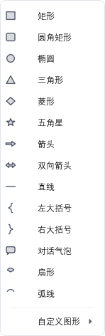

# StoryBoard 故事板

使用 **Qt 6 / C++17 / CMake** 编写的轻量故事板应用。一张画布由多个图层组成，图层里放笔画、图片、文字和图形；画布保存为 UTF-8 JSON（`.sbcanvas`），可继续编辑，也可导出 PNG / JPEG / PDF。


## 功能

按实现复杂度从高到低排列，常用操作放在后面。

- **图片线稿化**：`Ctrl+Shift+I`、文件菜单或工具栏导入图片，按颜色切块后逐块描轮廓，生成线宽固定为 1 的笔画，整体只占一条撤销记录。色块超过阈值时自动降低处理尺寸重算；档位、颜色级数、同色 / 相邻合并、最小色块、简化容差等参数与「设置 → 图片线稿化」共用一套值。参数窗改动默认只进内存，「保存到配置文件」才写回 `StoryBoard.ini`。

  | 档位 | 颜色级数 | 同色合并 | 相邻合并 | 最小色块 | 简化容差 |
  | --- | --- | --- | --- | --- | --- |
  | 保留细节 | 6 | 40 | 44 | 8 px | 0.5 px |
  | 均衡（默认） | 6 | 48 | 48 | 12 px | 0.6 px |
  | 线条干净 | 6 | 64 | 56 | 20 px | 0.8 px |
  | 大块概括 | 6 | 80 | 56 | 32 px | 1.0 px |

- **化形**：选中 2 个及以上图元，用「编辑 → 化形」、工具栏下拉按钮或画布右键菜单执行联合 / 组合 / 拆分 / 相交 / 剪除，子操作命名与图标参照 PPT「合并形状」，化形主入口用独立的形变图标以便和五项子操作区分。联合叠成一个合并图形；组合保留外轮廓并挖掉重叠区；拆分在每个重叠处切成多个可分别选中、拖动的独立合并图形；相交只留公共区域；剪除从最高优先级图元中挖掉其余图元。结果替换原图元，全程一条撤销记录。

  优先级先按图层顺序，同层再按 `height`。重叠区取优先级最高且有可见填充的图元颜色；该填充完全透明时依次退到下一优先级。落在合并图形内部的交界轮廓不描边，由所属图元的填充色覆盖；只有外轮廓和孔洞边界保留描边。合并图形的轮廓随画布保存。

- **自定义图形**：把 `.sbcanvas` 放进配置文件同级的 `shapes` 子目录，应用会自动扫描并追加到「常见图形 → 自定义图形」；便携包根目录的 `shapes` 也会扫描，同名模板以配置目录为准。模板只取图形 / 笔画 / 合并图形的矢量轮廓，忽略图片与文字，按外接矩形归一化并保持原宽高比。模板删除不影响已插入的画布。

- **常见图形几何**：矩形 / 圆角矩形默认插入为正方形；椭圆可编辑长半轴、短半轴，圆形、扇形、弧线由椭圆派生；扇形与弧线可编辑角度和半径；两种箭头默认填充。

- **图元分组与层级**：同层多选后 `Ctrl+G` 或右键组合，拖动任一成员整组移动。分组可嵌套；单击组内图元会选中整棵组树，双击仍可打开单个图元的属性窗。`Ctrl+Shift+G` 连同子组一起解散。分组、解组可撤销，层级随画布保存。

- **多图元对齐**：选中 2 个及以上图元，用「编辑 → 对齐」或工具栏下拉按钮做左 / 水平居中 / 右 / 上 / 垂直居中 / 下对齐；3 个及以上还可水平或垂直等间距，只占一条撤销记录。

- **编辑图元卡**：默认悬浮在画布左上，选中图元时出现「编辑图元」，无选中则隐藏；拖回主窗口停靠后常驻显示。卡片只编辑已有图元，不再列出常见图形（插入图形走「插入」菜单或工具栏）；选中后按行列出当前可执行的操作——单选时复制 / 删除 / 顺时针 / 逆时针旋转，多选时对齐 8 项与化形 5 项各展开成一行图标按钮（对齐需 2 个图元、等间距需 3 个），最后一行按选择是否还能再套一层显示组合 / 取消组合（组与普通图元混合选中时两者同时出现）。随后依次为填充样式、填充颜色、描线样式、描线颜色、描线宽度（选中的图元都不支持填充时，填充样式与填充颜色两行隐藏；描线颜色与描线宽度同时是画笔的当前颜色与粗细）；下方是透明度、矩形圆角、扇形 / 弧线扫过角与半径，最后是图层 ±1 与层内高度 ±1。修改直接写入图元并进入撤销栈。

- **卡片布局**：编辑图元卡默认悬浮，可拖回左侧停靠并转为常驻；原来的查看 / 编辑 / 画笔 / 文字模式栏作为「视图模式」卡默认停靠在右上角；图层树卡占据右下角剩余高度。右侧两张卡可拖动、浮动，上下顺序会写入设置并在下次启动恢复。

- **图元属性与复制**：选中后按 `Q` 或双击打开模态属性窗，任意模式可查看，仅编辑模式可编辑；名称、图层、层内高度、填充、描边、位置尺寸、旋转、圆角、文字或图片内容均可修改。矩形 / 圆角矩形可调圆角，圆角矩形默认显示短边 16% 的非零半径。`Ctrl+D` 复制图元，副本自动偏移并接续唯一名称。两者各只产生一条撤销记录。

- **图层与叠放**：背景固定为第 0 层；用户图层可新建、删除空图层、上移 / 下移、重命名、显示 / 隐藏、锁定。同层 `height` 唯一且越大越靠上；`]` / `[` 或右键调整层内高度，也可跨图层移动。

- **背景与画布**：背景层默认为无色纯透明，可设置纯色 / 图片背景（拉伸、适应、平铺）；辅助网格、画布外围颜色；四边四角可拖拽拉伸或裁剪，越界图元不会被删除。

- **导入与导出**：插入图片作为可移动图元；导出画布区域或全部图元为 PNG / JPEG / PDF，支持 0.25×–4×，可整体导出或按每个可见图层分别导出。PNG 保留透明背景，JPEG / PDF 自动合成白底；导出不包含网格、选中框和手柄。

- **画布文件**：图片与背景以 PNG 内嵌；文字保存字体、颜色与样式；图形保存类型、描边、填充、线宽、边框样式、透明度、圆角、扇形 / 弧线角度与半径、自定义轮廓。文件菜单直接列出画布目录中的 `.sbcanvas`，默认在用户配置目录的 `canvases` 下。

- **撤销 / 重做**：图元增删、移动缩放旋转、分组 / 解组、文字与图片编辑、样式修改、背景替换、画布尺寸、图层增删 / 排序、层内高度与跨图层移动均进入撤销栈，上限 300 步。

- **四种模式**：查看模式只改视图；编辑模式选择 / 移动 / 缩放 / 旋转 / 框选；画笔模式绘制并按容差平滑曲线，笔画的颜色与粗细就是描线颜色与描线宽度（菜单、工具栏、卡片统一使用这两个名称与图标）；文字模式点击画布插入文字。滚轮以光标为中心缩放，空格或中键拖动平移；查看模式左键也可平移。编辑模式的 `Ctrl` 用于加选 / 减选，不再用于平移。

- **界面语言**：简体中文 / English，可跟随系统，切换后立即生效；`STORYBOARD_LANG=zh|en` 可临时覆盖。



## 设置与导出

设置对话框集中管理画笔默认值、画布尺寸 / 外围颜色、图片线稿化的档位与参数；「保存」写入配置文件并作为新建画笔、新建画布和线稿化参数窗的默认值。


导出支持画布区域或全部图元、PNG / JPEG / PDF、0.25×–4×，可合并图层或按可见图层分别导出。


## 快捷键

应用内「帮助 → 快捷键一览…」会按当前动作实时汇总并允许改键，冲突时会提示占用者。下面只列常用项。

| 操作 | 快捷键 |
| --- | --- |
| 新建 / 打开 / 保存 / 另存为 | `Ctrl+N` / `Ctrl+O` / `Ctrl+S` / `Ctrl+Shift+S` |
| 插入图片 / 导入图片线稿化 / 导出 | `Ctrl+I` / `Ctrl+Shift+I` / `Ctrl+E` |
| 撤销 / 重做 | `Ctrl+Z` / `Ctrl+Y`（也支持 `Ctrl+Shift+Z`） |
| 全选 / 删除 / 复制 | `Ctrl+A` / `Delete` / `Ctrl+D` |
| 组合 / 取消组合 | `Ctrl+G` / `Ctrl+Shift+G` |
| 平滑选中笔画 | `Ctrl+Shift+M` |
| 顺 / 逆时针旋转 45° | `Ctrl+R` / `Ctrl+Shift+R` |
| 查看 / 画笔 / 编辑 / 文字模式 | `V` / `B` / `E` / `T` |
| 全景 / 放大 / 缩小 / 实际大小 | `Ctrl+0` 或 `Home` / `Ctrl+=` / `Ctrl+-` / `Ctrl+1` |
| 设置 | `Ctrl+,` |
| 调整层内高度 | `]` / `[` |
| 取消当前笔画 / 退出 | `Esc` / `Ctrl+Q` |

## 构建与运行

要求 Qt 6.5+、C++17、CMake 3.21+、GCC 15（Windows / Linux）或 Qt 官方 AppleClang（macOS）。

项目名自动取仓库根目录文件夹名：`project()`、可执行目标、Windows 版本资源、便携包目录都从它派生。版本只在 `CMakeLists.txt` 的 `project(... VERSION ...)` 维护，当前为 **1.0.0**。

源文件按文件夹收集：`STORYBOARD_SOURCE_FOLDERS` 默认列出 `src`、`src/scene`、`src/selftest`、`resources`，目录内新增或删除文件由 `CONFIGURE_DEPENDS` 自动同步。

Linux / macOS：

```bash
QT_DIR=${QT_DIR:-$HOME/Qt/6.12.0/gcc_64}   # macOS 改为 .../macos
cmake -S . -B build -DCMAKE_BUILD_TYPE=Release -DCMAKE_PREFIX_PATH="$QT_DIR"
cmake --build build -j
```

Windows（Git Bash / MSYS2，必须让 GCC 15 在 PATH 最前）：

```bash
export PATH="/d/Qt/Tools/mingw1510_64/bin:/d/Qt/6.12.0/mingw_64/bin:$PATH"
QT_DIR=/d/Qt/6.12.0/mingw_64
g++ --version
cmake -S . -B build -G "MinGW Makefiles" -DCMAKE_BUILD_TYPE=Release -DCMAKE_PREFIX_PATH="$QT_DIR"
cmake --build build -j
```

运行（`APP` 取当前目录名，Windows Git Bash 加 `.exe`）：

```bash
APP=$(basename "$PWD")
./build/bin/$APP
./build/bin/$APP examples/demo-canvas.sbcanvas
```

`translations/*.ts` 由构建时的 `lrelease` 生成 `.qm`，产物在构建目录并随资源编进可执行文件；源码目录只保留 `.ts`。也可以用 Qt Creator 打开根目录 `CMakeLists.txt`，选择本机 Qt 6 kit。

## 并行开发与打包

一个需求一棵工作树，从主干 `main` 的 HEAD 拉临时分支，在仓库旁的 `StoryBoard-worktrees/<需求名>` 独立开发。工作树里只写代码和自测，不部署打包；合并回主干后统一构建、自检和打包。需求按功能模块拆分，能复用的部分优先追加到相关度高的工作树。

```bash
bash scripts/worktree.sh new   <需求名>
bash scripts/worktree.sh list
bash scripts/worktree.sh merge <需求名>
bash scripts/worktree.sh drop  <需求名>
```

打包脚本同样在 bash 下运行，从根目录名推导应用名；发布时加 `--no-archive`，只保留目录：

```bash
bash scripts/package-portable.sh --help
bash scripts/package-portable.sh --build --qt-dir "$QT_DIR" --no-archive
```

| 主机 | 产物目录 | 部署 |
| --- | --- | --- |
| Windows | `<项目名>-<版本>-win64-portable/` | `windeployqt` + `qoffscreen.dll` |
| macOS | `<项目名>.app` | `macdeployqt` + `libqoffscreen.dylib` |
| Linux | `<项目名>-<版本>-linux-<arch>-portable/` | Qt 库、插件与 `qt.conf` |

Windows 分支已在 Windows 11 + GCC 15 + Qt 6.12 实机验证；macOS / Linux 分支按 Qt 官方部署方式提供，尚未在对应主机实机验证。

## 自检

```bash
APP=$(basename "$PWD")
QT_QPA_PLATFORM=offscreen ./build/bin/$APP --self-test build/selftest.txt
```

当前 Windows 基线为 **730 passed, 0 failed**，其他平台以实际 `SUMMARY` 为准。自检需要平台插件目录下的 offscreen 插件，打包脚本会自动补齐。

## 项目结构

```text
StoryBoard/
├─ CMakeLists.txt
├─ .clang-format        华为 C++ 规范基础：4 空格、120 列、函数大括号换行
├─ src/                 主窗口、场景 / 视图、图元、命令、对话框、设置、i18n
│  ├─ scene/            CanvasScene 按画布、图元、图层、序列化、叠放、命中拆分
│  ├─ selftest/         自检上下文、公共辅助与按功能段的测试入口
│  └─ *Controller.cpp   MainWindow 的文档、导入导出、编辑动作、插入等控制器
├─ resources/           图标、下拉箭头、qrc、Windows rc 模板
├─ translations/        storyboard_zh.ts 与 qtbase_zh_CN.qm
├─ scripts/             worktree.sh、package-portable.sh、各平台包内 README 模板
├─ examples/            示例画布与自定义图形模板
└─ docs/                README 截图与回归记录
```

开发约定：新写或拆分出的 `.cpp` 按 `cloc` 统计控制在 500 行以内，提交前格式化：

```bash
find src -type f \( -name '*.cpp' -o -name '*.h' \) -print0 | xargs -0 clang-format -i
```

## 已知限制

- 分组要求同层，可嵌套但只能整体解组；文字不支持同一图元内混排不同字号 / 颜色。
- 联合 / 组合 / 相交 / 剪除的结果是一个合并图形，不能拆回原图元；只有“拆分”会产出多个可分别选中的合并图形。
- 合并图形按路径整体缩放，不保留原图元的虚线、纹理填充等样式细节。
- 自定义图形只保留矢量轮廓，模板中的图片、文字不会进入图形；模板改动不会回写已有画布。
- 图层删除仅支持空图层；图层拖拽排序未提供，可用面板按钮上移 / 下移。
- 画布内嵌图片，包含大图时 `.sbcanvas` 会相应变大；撤销历史上限 300 步。
- 图片线稿化只按颜色切块，纯色或渐变背景也会被描出，需要时先裁掉或替换背景。
- macOS / Linux 的构建与打包分支已提供，但尚未在对应主机实机验证。
