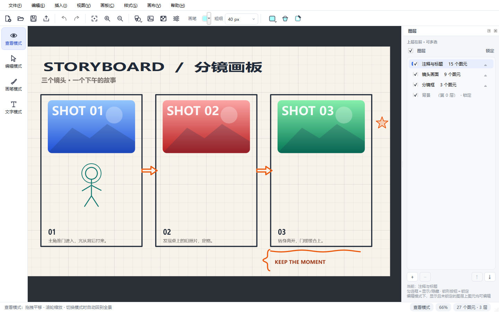
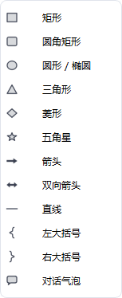
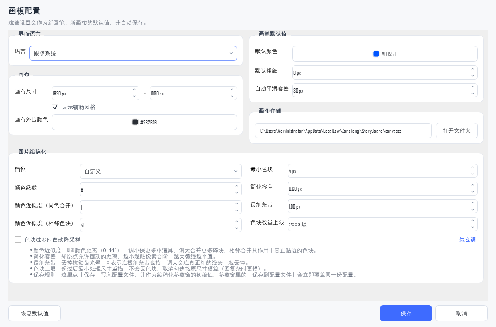
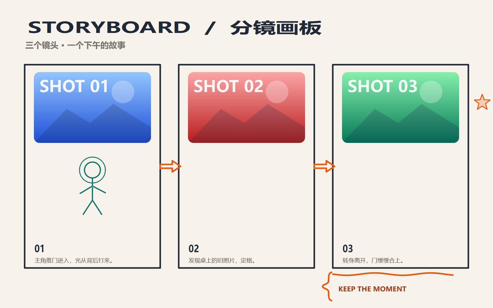

# StoryBoard 故事板

一个使用 **Qt 6 / C++17 / CMake** 编写的轻量故事板应用。英文名 **StoryBoard**，中文名「故事板」。

一个故事板可以包含多张**画布**；每张画布由多个**图层**组成，每个图层包含笔画、图片、文字和常见图形图元。画布以 UTF-8 JSON 保存为 `.sbcanvas`，可继续编辑，也可导出为图片或 PDF。



## 功能

- **四种模式**：查看、编辑、画笔、文字。查看模式只改变视图，不修改图元坐标；编辑模式支持选择、移动、缩放、旋转和框选；画笔模式绘制自由曲线；文字模式点击画布插入文字。
- **图元**：自由笔画、图片、文字，以及矩形、圆角矩形、椭圆、三角形、菱形、五角星、箭头、双向箭头、直线、左右大括号、对话气泡共 12 种常见图形。
- **插入图片**：`Ctrl+I` 或「插入 → 插入图片…」把图片作为可移动、可缩放的图片图元插入当前图层，同样支持拖拽文件到画布。
- **导入图片线稿化**：`Ctrl+I` 之外另设「文件 → 导入图片线稿化…」（紧跟在“打开画布”后面），快捷键 `Ctrl+Shift+I`。它把图片按颜色切块，再描出每块色块的轮廓，逐块生成线宽固定为 1 的笔画图元，整体只占一条撤销记录；色块数量不再设上限，图里有多少块就描多少块；识别到的色块超过阈值（默认 2000 块，可改）时自动降低处理尺寸重算，而不是丢掉色块，这个开关默认勾选、可以取消。切块参数在「设置 → 图片线稿化」里调：档位（保留细节 / 均衡 / 线条干净 / 大块概括）一键换掉全部参数（含简化容差），手动改任一项就切回“自定义”；细项是颜色级数、颜色近似度（同色合并）、颜色近似度（相邻色块）、最小色块面积、简化容差（轮廓点允许偏离的距离）、最细条带（平均宽度小于它的条带不描边，不随档位切换），以及色块数量上限与「超过上限时自动降采样」开关。参数窗和设置里的线稿化分组都带「怎么调」提示，逐项说明这些参数的取值方向和相互影响。参数窗里的改动默认只改内存、本次运行有效，点「保存到配置文件」才会覆盖 `StoryBoard.ini`；「恢复初始值」则把窗里的数值重新读回配置文件里当前保存的那一套；进程启动时参数窗的初始值来自配置文件，之后同一进程内沿用最近一次确认的参数。
- **图元属性**：选中图元后按 `Q` 或双击打开模态属性窗。任意模式可查看，仅编辑模式可编辑；名称、图层、层内高度、填充、描边、位置尺寸、旋转角度、文字正文/颜色/字体、图片名称与图片本体均可修改，确认后只生成一条撤销记录。图元名称在画布内唯一，手动改名遇到重名会提示，清空名称会自动补一个唯一名称。
- **图元拷贝**：`Ctrl+D` 或右键“复制图元”复制选中图元；副本相对原图元偏移，名称自动接续为唯一编号，整体只占一条撤销记录。
- **图元分组**：同层多选后按 `Ctrl+G` 或右键“组合选中图元”，拖动组内任意一个图元时整组一起移动；组员仍可单独选中、缩放、旋转，并按 `Q` 打开属性窗编辑自己的属性。`Ctrl+Shift+G` 或右键“取消组合选中图元”可解组，分组与解组都可撤销。
- **图层与叠放**：背景固定为第 0 层；用户图层可新建、删除空图层、上移/下移、重命名、显示/隐藏、锁定。同一图层内的 `height` 唯一，`]` / `[` 或右键可调整层内高度，也可跨图层移动。
- **背景与画布**：纯色/图片背景（拉伸、适应、平铺），辅助网格，画布外围颜色；画布四边四角可拖拽拉伸或裁剪，越界图元不会被删除。
- **撤销 / 重做**：图元增删、移动缩放旋转、分组/解组、文字与图片编辑、图形插入、背景替换、画布尺寸、图层增删/排序、层内高度与跨图层移动均进入撤销栈，上限 300 步。
- **画布文件**：图片与背景以 PNG 内嵌，文字保存字体、颜色、粗体/斜体/下划线/删除线字段，图形保存类型、描边、填充与线宽。
- **导出**：画布区域或全部图元，PNG / JPEG / PDF，0.25×–4×；可合并导出，也可按每个可见图层分别导出。
- **界面语言**：简体中文 / English，可跟随系统；切换后当前窗口立即生效，不需要重启。



## 构建与运行

要求：Qt 6.5+、C++17、CMake 3.21+；编译器可用 MinGW、MSVC、Clang 或 GCC。

项目版本号只在 `CMakeLists.txt` 的 `project(StoryBoard VERSION ...)` 维护；Windows 文件版本资源、关于对话框和便携包命名都从它派生，不要再单独写死版本号。

### Linux / macOS

```bash
cmake -S . -B out -DCMAKE_BUILD_TYPE=Release \
  -DCMAKE_PREFIX_PATH="$HOME/Qt/6.8.0/gcc_64"
cmake --build out -j
```

### Windows（Git Bash / MSYS2）

本机同时装有多套 MinGW（`D:\Qt\Tools` 下就有 `mingw1310_64`、`mingw1510_64`、`mingw810_64`），所以构建命令要**显式指定编译器版本**，否则会命中 PATH 里先出现的那套，和 Qt 6.12 的 `mingw_64` 二进制不匹配。下面是实机验证过的一版（Qt 6.12.0 + MinGW 13.1.0）：

```bash
cmake -S . -B out -G "MinGW Makefiles" -DCMAKE_BUILD_TYPE=Release \
  -DCMAKE_PREFIX_PATH="D:/Qt/6.12.0/mingw_64" \
  -DCMAKE_C_COMPILER="D:/Qt/Tools/mingw1310_64/bin/gcc.exe" \
  -DCMAKE_CXX_COMPILER="D:/Qt/Tools/mingw1310_64/bin/g++.exe"
export PATH="/d/Qt/Tools/mingw1310_64/bin:/d/Qt/6.12.0/mingw_64/bin:$PATH"
cmake --build out -j
```

配置完成后可以核对构建目录里的实际选择：

```bash
grep -E "CMAKE_(C|CXX)_COMPILER:|CMAKE_GENERATOR:" out/CMakeCache.txt
# CMAKE_CXX_COMPILER:FILEPATH=D:/Qt/Tools/mingw1310_64/bin/c++.exe
# CMAKE_GENERATOR:INTERNAL=MinGW Makefiles
```

PowerShell 里写法等价（路径用反斜杠，PATH 里必须先放 MinGW 13.1 与 Qt 的 bin）：

```powershell
$env:PATH = "D:\Qt\Tools\mingw1310_64\bin;D:\Qt\6.12.0\mingw_64\bin;C:\Windows\System32;" + $env:PATH
cmake --build "out" --parallel 8
```

翻译（`translations/*.ts`）里的中文在构建时由 `lrelease` 生成 `.qm`，产物写在**构建目录**（`out/storyboard_zh.qm`）并随资源编进 exe；源码目录只保留 `.ts`，不放 `.qm`。

### 运行

```bash
# Linux / macOS
./out/bin/StoryBoard

# Windows（Git Bash / MSYS2）
./out/bin/StoryBoard.exe

# 打开示例画布
./out/bin/StoryBoard examples/demo-canvas.sbcanvas
```

也可以直接用 Qt Creator 打开根目录的 `CMakeLists.txt`，选择本机对应的 Qt 6 kit。

## 便携打包

`scripts/package-portable.sh` 是跨平台打包入口，可在 Windows 的 Git Bash / MSYS2 / Cygwin、macOS 和 Linux 的 bash 中执行。脚本会定位 Qt、调用平台部署工具、补齐 offscreen 插件、运行包内自检，然后生成压缩包。

```bash
bash scripts/package-portable.sh --help

# 使用已有构建产物打包
bash scripts/package-portable.sh

# 先构建再打包
bash scripts/package-portable.sh --build

# 指定 Qt
bash scripts/package-portable.sh --build --qt-dir "$HOME/Qt/6.8.0/gcc_64"
```

| 主机 | 产物 | 部署方式 |
| --- | --- | --- |
| Windows（Git Bash / MSYS2 / Cygwin） | `StoryBoard-<ver>-win64-portable.zip` | `windeployqt` + 补 `qoffscreen.dll` |
| macOS | `StoryBoard.app` 及 `.zip` | `macdeployqt` + 补 `libqoffscreen.dylib` |
| Linux | `StoryBoard-<ver>-linux-<arch>-portable.tar.gz` | 拷贝 `libQt6*`、插件与 `qt.conf` |

Windows 分支已在 Windows 11 + MinGW + Qt 6.12 实机验证；macOS / Linux 分支按 Qt 官方部署方式提供，尚未在对应主机实机验证。自检默认要求 Windows 626 项，其他平台接受当前通过数；可用 `--expected-passed 0` 放宽，`--skip-self-test` 跳过（不推荐）。

## 使用说明

### 四种模式

| 模式 | 快捷键 | 说明 |
| --- | --- | --- |
| 查看模式 | `V` | 默认模式。左键拖拽平移，滚轮缩放；进入时自动全景显示所有可见图元。 |
| 编辑模式 | `E` | 选择/拖动图元，拖动 8 个控制点缩放；顶边上方旋转手柄按 5° 吸附旋转；空白处框选（需完整框住图元才选中）；按住 `Ctrl` 拖动平移整体视图、`Ctrl` 点击增选/取消选中图元；`Delete` 删除。 |
| 画笔模式 | `B` | 左键绘制自由曲线；收尾时按当前容差自动识别直线/曲线并平滑，设置中可关闭（0 = 关闭）；工具栏直接调整颜色、粗细与容差。 |
| 文字模式 | `T` | 点击画布插入默认文字图元并打开属性窗，确定后回到编辑模式并选中新文字。 |

任一模式都可用滚轮以光标为中心缩放，用空格或中键拖动平移；编辑模式额外支持按住 `Ctrl` 拖动平移整体视图。

### 图元与属性

- 选中单个图元后，四角与四边共 8 个控制点可缩放；按住 `Shift` 等比缩放。选中多个图元后拖动任意一个，全部一起移动。
- 同层选中至少两个图元后可按 `Ctrl+G` 组合；组合后拖动任意组员会带动整组，但单个组员仍可独立选中并缩放、旋转、打开属性窗。`Ctrl+Shift+G` 取消组合。
- 旋转手柄按 5° 步长旋转；`Ctrl+R` / `Ctrl+Shift+R` 顺/逆时针旋转 45°。
- 双击图元或按 `Q` 打开属性窗。文字正文、字体、字号、颜色、图片名称与图片本体都在属性窗内编辑，不再提供独立文字对话框。
- 文字正文变化后，图元尺寸自动重置为文字自然尺寸；替换图片后，尺寸重置为新图片原始像素尺寸。
- 右键图元可复制、组合/取消组合、调整层内高度、跨图层移动或删除；多选时批量作用于全部选中图元。
- 选中笔画后，可点画笔工具栏的“平滑笔画”按钮、按 `Ctrl+Shift+M` 或使用右键/画笔菜单，按当前容差再平滑一次；容差可直接在画笔工具栏调整。

### 图层与叠放

- 背景固定为第 0 层，不能接收图元、不能删除/上移/解锁。
- 用户图层按上层在前显示；新建图层放在最上层。新图元进入当前图层。
- 同一图层内按 `height` 从小到大绘制，`height` 越大越靠上；新建图元取当前层最大 `height + 1`，同层内唯一。
- 图层顺序优先级高于层内 `height`；高优先级纯色填充图元会完整遮挡下层。
- 可见且未锁定的图层才可编辑；隐藏或锁定图层上的图元不响应点选、框选、拖动、双击和右键菜单。
- 图层面板表头三态勾选框可全部显示/全部隐藏；单行勾选框控制显示，锁形按钮控制锁定。选中隐藏图层会自动显示，隐藏当前图层会自动切换到最近的可见图层。

### 背景、设置与语言

- **插入 → 替换背景图片…**：纯色、图片（拉伸/适应/平铺）或清除背景（原“画布”菜单已并入插入菜单，背景四项排在“插入图片”之前）。
- **视图 → 辅助网格**：直接勾选/取消画布网格，和「设置 → 画布 → 显示辅助网格」共用同一份配置，改哪边都会同步。
- **文件 → 设置…**（`Ctrl+,`）：默认画笔颜色/粗细、画笔自动平滑容差、画布尺寸、画布外围颜色、画布存储目录、界面语言、图片线稿化参数（档位与各项细项）。版面安排：标题行右侧是「界面语言」下拉；下一行左边「画笔默认值」、右边「画布」（尺寸、外围颜色、存储目录合为一组），图片线稿化整组独占再下一行（组内 8 个数值项分左右两列，行数减半）；补充说明都收进控件的 tooltip，线稿化的「色块过多时自动降采样」复选框与「怎么调」折叠开关并排一行，整页高度约 625px，1080p 屏幕一屏放下不用滚动。辅助网格不在这里，走 **视图 → 辅助网格** 菜单开关。窗口尺寸随内容自适应：最小宽度取内容最小宽度加余量（英文标签、高 DPI 都不会截断右侧），高度按内容真实高度计算并按屏幕可用高度夹取，屏幕较矮时才出现纵向滚动条。线稿化的「怎么调」说明默认展开，点一下即可折叠。
- **帮助 → 快捷键一览…**：按当前动作自动汇总所有带快捷键的条目（动作名 + 组合键），分三栏排布，新增快捷键后清单自动跟上。点条目右侧的组合键即可改键（弹出按键捕获框；按 Esc 关闭一览窗口）。新键与现有动作冲突时会提示被谁占用，并放弃本次修改。改完立即写入 `StoryBoard.ini` 的 `[shortcuts]` 段，重启后仍然生效；「恢复默认快捷键」清空该段，回到代码里的默认键。



- 界面支持跟随系统 / 简体中文 / English；`STORYBOARD_LANG=zh|en` 可临时覆盖。
- 应用内颜色选择使用 Qt 自绘对话框，字体选择也强制使用 Qt 自绘对话框，避免原生窗口语言不受应用控制。

### 图片线稿化参数

入口是「文件 → 导入图片线稿化…」（`Ctrl+Shift+I`）或工具栏的同名按钮；选完图片先弹参数窗，确定后才生成笔画。参数窗与「设置 → 图片线稿化」共用同一套选项和同一份档位表：

| 参数 | 默认 | 调法 |
| --- | --- | --- |
| 档位 | 均衡 | 保留细节 / 均衡 / 线条干净 / 大块概括一键换掉下面五项（含简化容差）；手动改任一项立即回到“自定义” |
| 颜色级数 | 6 | 每个通道切几级；级数越多越保细微明暗，也越容易切出碎块 |
| 颜色近似度（同色合并） | 48 | RGB 距离 0–441；调小保更多小道具，调大合并更多碎块 |
| 颜色近似度（相邻色块） | 48 | 只合并真正贴边的两块；0 表示不合并 |
| 最小色块面积 | 12 px | 小于它的色块不描；调小能留下更小的道具，也会带出噪点 |
| 简化容差 | 0.6 px | 轮廓点允许挪动的距离；越小越贴像素台阶（锯齿更明显），越大弧线越平直、线段更少 |
| 最细条带 | 1.0 px | 平均宽度小于它的条带不描；0 表示连极细条带也描，调大能压掉抗锯齿光晕，也会丢掉真正细的线条 |
| 色块数量上限 / 自动降采样 | 2000 块 / 勾选 | 识别到的色块超过上限时缩小处理尺寸重描，色块数量不变、只是更省时；取消勾选按原尺寸硬算，图复杂时明显变慢 |

线宽固定为 1，不随任何参数变化。参数窗里的改动只进内存、本次运行生效；点「保存到配置文件」才把当前值写进 `StoryBoard.ini`（只覆盖 `lineArt/*` 键，其它设置原样保留）；点「恢复初始值」重新读回配置文件里的当前值，丢掉本次未保存的改动。「设置」里的同名分组随「保存」落盘，并作为参数窗的初始值。

### 画布文件

- 文件菜单直接列出画布目录中的 `.sbcanvas` 文件（原“画板”菜单已并入文件菜单，位于“退出”之上，含设置、最近画布与打开画布文件夹）；默认目录为 `%APPDATA%\ZoneTong\StoryBoard\canvases`。
- 示例画布：[examples/demo-canvas.sbcanvas](examples/demo-canvas.sbcanvas)



- 画布 JSON 保存画布范围、图层顺序/显示/锁定、当前图层，以及每个图元的 `layer` / `height` / `group`。
- 文字额外保存 `fontFamily`、`fontSize`、`fontWeight`、`italic`、`underline`、`strikeOut`、`color`。
- 图形额外保存 `shapeType`、`strokeColor`、`fillColor`、`strokeWidth`、`fillStyle`。

### 导出

- 范围：画布区域或全部图元；格式：PNG / JPEG / PDF；比例 0.25×–4×。
- 可按每个可见图层分别导出，文件名格式为 `<基础名>_L<图层 id>_<图层名>.<扩展名>`；图层名里的非法文件名字符替换为 `_`，超过 40 个字符会截断。
- 导出不包含网格、选中框和手柄；隐藏图层不导出。


### 快捷键

应用内「帮助 → 快捷键一览…」会按当前动作实时汇总全部快捷键，下面只列常用项。所有带快捷键的动作，提示文字里也会带上组合键。

| 操作 | 快捷键 |
| --- | --- |
| 新建 / 打开 / 保存 / 另存为 | `Ctrl+N` / `Ctrl+O` / `Ctrl+S` / `Ctrl+Shift+S` |
| 插入图片 / 导入图片线稿化 / 导出画布 | `Ctrl+I` / `Ctrl+Shift+I` / `Ctrl+E` |
| 撤销 / 重做 | `Ctrl+Z` / `Ctrl+Y`（也支持 `Ctrl+Shift+Z`） |
| 全选 / 删除 | `Ctrl+A` / `Delete` |
| 复制选中图元 | `Ctrl+D` |
| 组合 / 取消组合选中图元 | `Ctrl+G` / `Ctrl+Shift+G` |
| 平滑选中笔画 | `Ctrl+Shift+M` |
| 顺时针 / 逆时针旋转 45° | `Ctrl+R` / `Ctrl+Shift+R` |
| 查看 / 画笔 / 编辑 / 文字模式 | `V` / `B` / `E` / `T` |
| 回到全景 / 放大 / 缩小 / 实际大小 | `Ctrl+0` 或 `Home` / `Ctrl+=` / `Ctrl+-` / `Ctrl+1` |
| 设置 | `Ctrl+,` |
| 取消当前笔画 | `Esc` |
| 调整层内高度 | `]` / `[` |
| 退出 | `Ctrl+Q` |

「快捷键一览」窗口里点组合键可以改成自己的习惯键（例如把全选改成 `Ctrl+Shift+A`），冲突会提示，改完写进配置、重启后照样生效；想回到出厂键就按「恢复默认快捷键」。

## 自检

```bash
# Linux / macOS
QT_QPA_PLATFORM=offscreen ./out/bin/StoryBoard --self-test out/selftest.txt
cat out/selftest.txt

# Windows 的 Git Bash / MSYS2
QT_QPA_PLATFORM=offscreen ./out/bin/StoryBoard.exe --self-test out/selftest.txt
cat out/selftest.txt
```

当前 Windows 基线为 **626 passed, 0 failed**；其他平台以实际 `SUMMARY` 为准。

`--self-test` 需要平台插件目录下的 offscreen 插件（Windows `platforms/qoffscreen.dll`、macOS `platforms/libqoffscreen.dylib`、Linux `platforms/libqoffscreen.so`）。打包脚本会自动补齐。

开发用截图/渲染参数：

```bash
./out/bin/StoryBoard --render-demo out/demo.png
./out/bin/StoryBoard --demo-canvas examples/demo-canvas.sbcanvas
./out/bin/StoryBoard --ui-screenshot out/ui.png
./out/bin/StoryBoard --item-properties-screenshot out/props.png
./out/bin/StoryBoard --settings-screenshot out/settings.png
```

`--settings-screenshot` 只弹设置窗并把它自己抓成图片，不需要人工截图；配合 `QT_QPA_PLATFORM=offscreen` 和 `QT_QPA_FONTDIR`（Windows 指向 `C:\Windows\Fonts`）就能在后台生成中文完整的文档图，不会占用桌面。

> Windows 下把 `./out/bin/StoryBoard` 换成 `./out/bin/StoryBoard.exe`。

## 项目结构

```text
StoryBoard/
├─ CMakeLists.txt
├─ .clang-format        代码风格（以华为 C++ 规范为基础：4 空格缩进、120 列、函数大括号换行、强制补大括号、include 分组排序）
├─ src/                 主窗口、画布场景/视图、图元、命令、对话框、设置、i18n、自检
├─ resources/           图标、下拉箭头、qrc、Windows rc 模板
├─ translations/        storyboard_zh.ts 与 qtbase_zh_CN.qm
├─ scripts/             package-portable.sh 与各平台包内 README 模板
├─ examples/            示例画布
└─ docs/                README 截图
```

提交前格式化：`clang-format -i --style=file src/*.cpp src/*.h tools/lineart-similarity/*.cpp`（`src` 与 `tools` 的 C++ 源文件已按该配置全量整理过一遍）。

核心实现：

- 图元只存在于场景坐标；查看模式只改变 `QGraphicsView` 视口变换。
- 绘制顺序由 `QGraphicsItem::zValue = 图层序号 × 1000000 + height` 推导。
- 图元命中以 `shape()` 为准，选中手柄、粗描边区域都并入命中范围。
- 文字用 `QFontMetricsF` 计算自然尺寸，缩放时按比例调整字号与行距。
- 图形用 `QPainterPath` 描述，支持纯色与多种纹理填充；纯色填充参与完全遮挡。
- 画布载入时修复重复 `height`，未知图元类型会被拒绝，避免半加载。

## 已知限制

- 图元分组要求同层，暂不支持组嵌套；文字不支持同一图元内混排不同字号/颜色。
- 图形不支持逐图元独立设置描边线宽或虚线。
- 图层删除仅支持空图层；图层拖拽排序尚未提供，可用面板按钮上移/下移。
- 画布内嵌图片，包含大图时 `.sbcanvas` 会相应变大。
- 撤销历史上限 300 步；删除的图元在文档重置前保留在内存中以便重做。
- 图片线稿化只按颜色切块，不区分主体与背景：纯色或渐变背景也会被当色块描出来，需要时先把背景裁掉或替换。
- 取消「超过上限时自动降采样」后，大图按原处理尺寸硬算，笔画数可能上千、耗时明显变长。
- 应用运行验证目前在 Windows 11 + MinGW 完成；macOS / Linux 的构建与打包分支已提供，但尚未实机验证。
