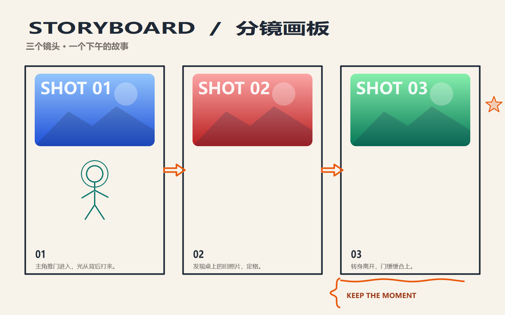

# StoryBoard 故事板

一个使用 **Qt 6 / C++17 / CMake** 编写的轻量故事板应用。英文名 **StoryBoard**，中文名「故事板」。

一个故事板包含多张**画布**；每张画布由多个**图层**组成，图层里放笔画、图片、文字和图形图元。画布以 UTF-8 JSON 保存为 `.sbcanvas`，可继续编辑，也可导出为图片或 PDF。


## 功能

按实现复杂度从高到低排列，基础操作放在后面。

- **图片线稿化**：`Ctrl+Shift+I` 或「文件 → 导入图片线稿化…」，也可用工具栏同名按钮。按颜色切块后逐块描轮廓，生成线宽固定为 1 的笔画图元，整体只占一条撤销记录。色块超过阈值（默认 2000，可调）时自动降低处理尺寸重算，不丢色块；取消该开关则按原尺寸硬算。档位（保留细节 / 均衡 / 线条干净 / 大块概括）一键切换颜色级数、同色合并、相邻合并、最小色块面积与简化容差，手动改任一项即回到“自定义”；另有最细条带与色块数量上限。参数窗和「设置 → 图片线稿化」共用同一套选项，参数窗里的改动默认只进内存，点「保存到配置文件」才写回 `StoryBoard.ini`，「恢复初始值」重新读回配置。
- **合并形状**：选中 2 个及以上图元后，用「编辑 → 合并形状」、工具栏的合并形状下拉按钮或画布右键菜单里的同一组命令执行联合 / 组合 / 拆分 / 相交 / 剪除，命名与 PPT「合并形状」一致：联合叠成布尔图形；组合合并轮廓并挖掉重叠区；拆分把每个重叠处切成互不重叠的多块；相交只留公共区域；剪除以最高优先级图元为底挖掉其余图元。结果替换为布尔图形，原图元移除，全程一条撤销记录。重叠区整块取优先级更高的图元的颜色——图层更高、同层 `height` 更大的图元优先，其填充色盖住下层填充，重叠区里的下层轮廓被裁掉，边界上的轮廓颜色同样取高层图元的描边色。布尔图形的轮廓数据随画布保存。
- **自定义图形**：把画布文件（`.sbcanvas`）放进配置文件所在目录的 `shapes` 子目录（便携包根目录下的 `shapes` 同样会被扫描），应用启动或展开菜单时自动扫描，按文件名追加到「常见图形 → 自定义图形」下拉菜单。模板只取图形 / 笔画 / 复合图元的矢量轮廓，合并后归一化到 0–1 单位坐标，插入时按原始宽高比缩放，并沿用当前画笔与填充设置。轮廓数据随画布保存，模板文件删掉也不影响已有画布。
- **图元分组与层级**：同层多选后 `Ctrl+G` 或右键“组合选中图元”，拖动组内任一图元整组移动，组员仍可单独缩放、旋转或打开属性窗。分组可嵌套：已分组的图元再参与组合会成为新组的子组，单击组内图元即选中整棵组树；`Ctrl+Shift+G` 连同子组一起解散。分组、解组都可撤销，层级关系随画布保存。
- **多图元对齐**：选中 2 个及以上图元，用「编辑 → 对齐」或工具栏对齐下拉按钮做左 / 水平居中 / 右 / 上 / 垂直居中 / 下对齐；选中 3 个及以上还能水平或垂直等间距。以选中图元整体外接矩形为基准逐个平移，只占一条撤销记录。
- **编辑图元卡**：选中图元时右侧自动出现「编辑图元」dock 卡片，无选中自动收起，与图层卡上下排列（默认图层卡在上，顺序可拖拽并自动记忆）。紧凑布局无折叠分组标题：常见图形（图标按钮）、常用颜色（描边与填充各一排色块）、填充样式（纹理缩略图标）、边框样式（实线 / 虚线 / 点线 / 点划线，含线宽）、透明度、矩形圆角，以及图层 ±1、层内高度 ±1 图标按钮。样式修改直接写入选中图元并进入撤销栈；没选中图形时点常见图形等于插入新图形。
- **图元属性**：选中图元后按 `Q` 或双击打开模态属性窗。任意模式可查看，仅编辑模式可编辑；名称、图层、层内高度、填充、描边、位置尺寸、旋转角度、文字正文 / 颜色 / 字体、图片名称与图片本体均可修改，确认后只生成一条撤销记录。图元名称在画布内唯一，重名会提示，清空后自动补一个唯一名称。
- **图元拷贝**：`Ctrl+D` 或右键“复制图元”；副本相对原图元偏移，名称自动接续为唯一编号，整体一条撤销记录。
- **图层与叠放**：背景固定为第 0 层；用户图层可新建、删除空图层、上移 / 下移、重命名、显示 / 隐藏、锁定。同层 `height` 唯一，`]` / `[` 或右键调整层内高度，也可跨图层移动。
- **背景与画布**：纯色 / 图片背景（拉伸、适应、平铺），辅助网格，画布外围颜色；画布四边四角可拖拽拉伸或裁剪，越界图元不会被删除。
- **导出**：画布区域或全部图元，PNG / JPEG / PDF，0.25×–4×；可合并导出，也可按每个可见图层分别导出。
- **画布文件**：图片与背景以 PNG 内嵌；文字保存字体、颜色、粗体 / 斜体 / 下划线 / 删除线；图形保存类型、描边、填充、线宽、边框样式、透明度、圆角与自定义轮廓。
- **撤销 / 重做**：图元增删、移动缩放旋转、分组 / 解组、文字与图片编辑、图形插入与样式修改、背景替换、画布尺寸、图层增删 / 排序、层内高度与跨图层移动均进入撤销栈，上限 300 步。
- **四种模式**：查看、编辑、画笔、文字；查看只改变视图，编辑支持选择 / 移动 / 缩放 / 旋转 / 框选，画笔绘制自由曲线，文字模式点击画布插入文字。
- **界面语言**：简体中文 / English，可跟随系统；切换后当前窗口立即生效，无需重启。


## 构建与运行

要求：Qt 6.5+、C++17、CMake 3.21+。Windows / Linux 使用 **GCC 15**（Qt 官方 `mingw1510_64` / `gcc_64` 工具链），macOS 使用 Qt 官方 AppleClang 工具链。

项目版本号只在 `CMakeLists.txt` 的 `project(StoryBoard VERSION ...)` 维护；Windows 文件版本资源、关于对话框和便携包命名都从它派生。

### Linux / macOS

```bash
# Linux：确认 gcc/g++ 为 15.x
g++ --version

cmake -S . -B out -DCMAKE_BUILD_TYPE=Release \
  -DCMAKE_PREFIX_PATH="$HOME/Qt/6.12.0/gcc_64" \
  -DCMAKE_C_COMPILER=gcc -DCMAKE_CXX_COMPILER=g++
cmake --build out -j
```

macOS 把 `CMAKE_PREFIX_PATH` 指向 `~/Qt/6.12.0/macos`，编译器用 `clang` / `clang++`。

### Windows（Git Bash / MSYS2）

本机同时装有多套 MinGW（`D:\Qt\Tools` 下有 `mingw1310_64`、`mingw1510_64`、`mingw810_64`），必须显式指定 GCC 15，否则会命中 PATH 里先出现的那套。下面是实机验证过的一版（Qt 6.12.0 + MinGW GCC 15.1.0）：

```bash
cmake -S . -B out -G "MinGW Makefiles" -DCMAKE_BUILD_TYPE=Release \
  -DCMAKE_PREFIX_PATH="D:/Qt/6.12.0/mingw_64" \
  -DCMAKE_C_COMPILER="D:/Qt/Tools/mingw1510_64/bin/gcc.exe" \
  -DCMAKE_CXX_COMPILER="D:/Qt/Tools/mingw1510_64/bin/g++.exe"
export PATH="/d/Qt/Tools/mingw1510_64/bin:/d/Qt/6.12.0/mingw_64/bin:$PATH"
cmake --build out -j
```

配置后核对实际选择：

```bash
grep -E "CMAKE_(C|CXX)_COMPILER:|CMAKE_GENERATOR:" out/CMakeCache.txt
# CMAKE_CXX_COMPILER:FILEPATH=D:/Qt/Tools/mingw1510_64/bin/c++.exe
# CMAKE_GENERATOR:INTERNAL=MinGW Makefiles
```

PowerShell 等价写法（PATH 里先放 GCC 15 与 Qt 的 bin）：

```powershell
$env:PATH = "D:\Qt\Tools\mingw1510_64\bin;D:\Qt\6.12.0\mingw_64\bin;C:\Windows\System32;" + $env:PATH
cmake --build "out" --parallel 8
```

`translations/*.ts` 的中文由构建时的 `lrelease` 生成 `.qm`，产物写在构建目录并随资源编进 exe；源码目录只保留 `.ts`。

### 运行

```bash
./out/bin/StoryBoard                 # Linux / macOS
./out/bin/StoryBoard.exe             # Windows
./out/bin/StoryBoard examples/demo-canvas.sbcanvas
```

也可以用 Qt Creator 打开根目录的 `CMakeLists.txt`，选择本机对应的 Qt 6 kit。

## 并行开发（git 工作树）

多个需求同时推进时，一个需求一棵工作树：从主干当前 HEAD 拉临时分支 `feature/<需求名>`，在旁边的 `StoryBoard_<需求名>` 目录里独立改代码；工作树里不跑自检、不打包，合并回主干后才在主干目录构建、自检和打包。

```bash
bash scripts/worktree.sh new   <需求名>          # 建工作树（默认从 main 拉）
bash scripts/worktree.sh list                    # 列出工作树
bash scripts/worktree.sh merge <需求名>          # 合并进主干，成功后删工作树与临时分支
bash scripts/worktree.sh drop  <需求名>          # 丢弃工作树（含未合并的提交）
```

合并用 `--no-ff` 保留需求分支的提交；冲突时脚本停下并打印冲突文件，解决后重跑 `merge`。新功能尽量按功能拆类拆文件，减少并行冲突。

## 便携打包

`scripts/package-portable.sh` 是跨平台打包入口，可在 Windows 的 Git Bash / MSYS2 / Cygwin、macOS 和 Linux 的 bash 中执行。脚本负责定位 Qt、调用平台部署工具、补齐 offscreen 插件、运行包内自检并生成压缩包。

```bash
bash scripts/package-portable.sh --help
bash scripts/package-portable.sh --build                     # 先构建再打包
bash scripts/package-portable.sh --build --qt-dir "$HOME/Qt/6.8.0/gcc_64"
```

| 主机 | 产物 | 部署方式 |
| --- | --- | --- |
| Windows（Git Bash / MSYS2 / Cygwin） | `StoryBoard-<ver>-win64-portable.zip` | `windeployqt` + 补 `qoffscreen.dll` |
| macOS | `StoryBoard.app` 及 `.zip` | `macdeployqt` + 补 `libqoffscreen.dylib` |
| Linux | `StoryBoard-<ver>-linux-<arch>-portable.tar.gz` | 拷贝 `libQt6*`、插件与 `qt.conf` |

Windows 分支已在 Windows 11 + GCC 15 + Qt 6.12 实机验证；macOS / Linux 分支按 Qt 官方部署方式提供，尚未在对应主机实机验证。自检默认要求 Windows 682 项，其他平台接受当前通过数；可用 `--expected-passed 0` 放宽，`--skip-self-test` 跳过（不推荐）。

## 使用说明

### 四种模式

| 模式 | 快捷键 | 说明 |
| --- | --- | --- |
| 查看模式 | `V` | 默认模式。左键拖拽平移，滚轮缩放；进入时自动全景显示所有可见图元。 |
| 编辑模式 | `E` | 选择 / 拖动图元，拖动 8 个控制点缩放；顶边上方旋转手柄按 5° 吸附旋转；空白处框选（需完整框住图元才选中）；`Ctrl` 点击增选 / 取消选中；`Delete` 删除。 |
| 画笔模式 | `B` | 左键绘制自由曲线；收尾时按当前容差识别直线 / 曲线并平滑，0 表示关闭；工具栏直接调整颜色、粗细与容差。 |
| 文字模式 | `T` | 点击画布插入默认文字并打开属性窗，确定后回到编辑模式并选中新文字。 |

任一模式都可用滚轮以光标为中心缩放，空格或中键拖动平移；编辑模式额外支持按住 `Ctrl` 拖动平移整体视图。

### 编辑与图元

- 选中单个图元后，四角与四边共 8 个控制点可缩放，按住 `Shift` 等比缩放；选中多个图元后拖动任意一个，全部一起移动。
- 旋转手柄按 5° 步长旋转；`Ctrl+R` / `Ctrl+Shift+R` 顺 / 逆时针旋转 45°。
- 双击图元或按 `Q` 打开属性窗；文字正文、字体、字号、颜色、图片名称与图片本体都在属性窗内编辑，不再提供独立文字对话框。
- 文字正文变化后图元尺寸自动重置为文字自然尺寸；替换图片后尺寸重置为新图原始像素尺寸。
- 右键图元可复制、组合 / 取消组合、调整层内高度、跨图层移动或删除；多选时批量作用于全部选中图元。
- 选中笔画后，可用画笔工具栏“平滑笔画”、`Ctrl+Shift+M` 或右键 / 画笔菜单，按当前容差再平滑一次。

### 编辑图元卡

卡片只在编辑模式且有选中图元时出现，右侧与图层面板上下排列，也可在「视图 → 编辑图元卡」手动开关。整卡为紧凑图标化布局，无折叠分组标题，各行以小图标标注用途。

右侧默认图层卡在上、编辑图元卡在下，两张卡都限定了高度区间，不会铺满整列，开关编辑卡时图层卡的高度变化很小。拖动卡片标题栏可互换上下顺序，顺序自动写入配置文件（`layout/dockOrder`），下次启动按保存的顺序恢复。

- 常见图形：点击切换选中图形类型；未选中图形时点击即插入新图形。
- 常用颜色：描边 / 填充各一排预设色块，末尾色块按钮打开自定义颜色（支持透明度）。
- 填充样式：无填充、纯色、斜线、反斜线、正交叉线、网格、六边形；对支持填充的图形生效。
- 边框样式：实线 / 虚线 / 点线 / 点划线，并可调边框粗细。
- 透明度：0–100%，作用于整个图形（填充与边框一起变淡）。
- 圆角：仅矩形 / 圆角矩形显示，0 为直角，单位与画布像素一致。
- 图层 / 高度：图层 ±1 跨层移动，高度 ±1 调整同层叠放顺序，都会进入撤销栈。

### 自定义图形目录

- 目录位置：与 `StoryBoard.ini` 同级的 `shapes` 子目录。便携版里有 `StoryBoard.ini` 时就是 exe 旁的 `shapes`；否则在 `%APPDATA%\ZoneTong\StoryBoard\shapes`（Linux / macOS 对应配置目录）。
- 部署目录也参与扫描：程序还会读取可执行文件所在目录下的 `shapes`（便携包根目录里的那个），两个目录都存在时先扫配置目录、再扫部署目录，同名模板以配置目录里的那份为准。这样把模板随包分发时直接放进包根目录的 `shapes` 即可，用户不必再去配置目录里复制。
- 用法：在应用里画好图形并保存为 `.sbcanvas`，把文件复制进 `shapes` 目录；展开「常见图形 → 自定义图形」即可看到，文件名就是菜单名。
- 便携包里自带 `shapes/` 目录与示例模板 `样例-五角星.sbcanvas`，装好就能在「自定义图形」里看到它；往这个目录里增删 `.sbcanvas`、重启应用即可调整模板。
- 模板只取图形 / 笔画 / 复合图元的矢量轮廓，图片与文字会被忽略；多个图元会合并成一条轮廓并按外接矩形归一化，插入时保持原始宽高比。
- 解析失败的文件不会出现在菜单里，菜单底部的“有 N 个图形文件无法读取”会汇总数量；「打开 shapes 目录…」可直接定位目录。

### 图层与叠放

- 背景固定为第 0 层，不能接收图元、不能删除 / 上移 / 解锁。
- 用户图层按上层在前显示，新建图层放在最上层，新图元进入当前图层。
- 同一图层内按 `height` 从小到大绘制，越大越靠上；新建图元取当前层最大 `height + 1`，同层唯一。
- 图层顺序优先级高于层内 `height`；高优先级纯色填充图元会完整遮挡下层。
- 可见且未锁定的图层才可编辑；隐藏或锁定图层上的图元不响应点选、框选、拖动、双击和右键菜单。
- 图层面板表头三态勾选框可全部显示 / 全部隐藏；单行勾选框控制显示，锁形按钮控制锁定。选中隐藏图层会自动显示，隐藏当前图层会自动切到最近的可见图层。

### 背景、设置与语言

- **插入 → 替换背景图片…**：纯色、图片（拉伸 / 适应 / 平铺）或清除背景；背景四项排在“插入图片”之前。
- **视图 → 辅助网格**：直接开关画布网格，与「设置 → 画布 → 显示辅助网格」共用同一份配置。
- **文件 → 设置…**（`Ctrl+,`）：默认画笔颜色 / 粗细、自动平滑容差、画布尺寸、外围颜色、画布存储目录、界面语言、图片线稿化参数（档位与细项）。标题行右侧是界面语言下拉；下一行左侧画笔默认值、右侧画布分组；线稿化整组独占一行，组内 8 个数值项分左右两列。补充说明收进 tooltip，整页高度约 625px，1080p 屏幕一屏放下。窗口尺寸随内容自适应，高 DPI 或英文标签不会截断右侧。
- **帮助 → 快捷键一览…**：按当前动作自动汇总所有带快捷键的条目（动作名 + 组合键），分三栏排布。点组合键即可改键；与现有动作冲突时提示被谁占用并放弃修改。改完立即写入 `StoryBoard.ini` 的 `[shortcuts]` 段，「恢复默认快捷键」清空该段。


- 界面支持跟随系统 / 简体中文 / English；`STORYBOARD_LANG=zh|en` 可临时覆盖。
- 颜色选择与字体选择都强制使用 Qt 自绘对话框，避免原生窗口语言不受应用控制。

### 图片线稿化参数

参数窗与「设置 → 图片线稿化」共用同一套选项和同一份档位表：

| 参数 | 默认 | 调法 |
| --- | --- | --- |
| 档位 | 均衡 | 保留细节 / 均衡 / 线条干净 / 大块概括一键换掉下面五项（含简化容差）；手动改任一项立即回到“自定义” |
| 颜色级数 | 6 | 每个通道切几级；级数越多越保细微明暗，也越容易切出碎块 |
| 颜色近似度（同色合并） | 48 | RGB 距离 0–441；调小保更多小道具，调大合并更多碎块 |
| 颜色近似度（相邻色块） | 48 | 只合并真正贴边的两块；0 表示不合并 |
| 最小色块面积 | 12 px | 小于它的色块不描；调小能留下更小的道具，也会带出噪点 |
| 简化容差 | 0.6 px | 轮廓点允许挪动的距离；越小越贴像素台阶，越大弧线越平直、线段更少 |
| 最细条带 | 1.0 px | 平均宽度小于它的条带不描；0 表示连极细条带也描，调大能压掉抗锯齿光晕，也会丢掉真正细的线条 |
| 色块数量上限 / 自动降采样 | 2000 块 / 勾选 | 超过上限时缩小处理尺寸重描，色块数量不变、只是更省时；取消后按原尺寸硬算，图复杂时明显变慢 |

线宽固定为 1，不随参数变化。「保存到配置文件」只覆盖 `lineArt/*` 键，其它设置原样保留；「恢复初始值」重新读回配置文件里的当前值。「设置」里的同名分组随「保存」落盘，并作为参数窗初始值。

### 画布文件

- 文件菜单直接列出画布目录中的 `.sbcanvas`（原“画板”菜单已并入文件菜单，位于“退出”之上，含设置、最近画布与打开画布文件夹）；默认目录 `%APPDATA%\ZoneTong\StoryBoard\canvases`。
- 示例画布：[examples/demo-canvas.sbcanvas](examples/demo-canvas.sbcanvas)



- 画布 JSON 保存画布范围、图层顺序 / 显示 / 锁定、当前图层，以及每个图元的 `layer` / `height` / `group`。
- 文字额外保存 `fontFamily`、`fontSize`、`fontWeight`、`italic`、`underline`、`strikeOut`、`color`。
- 图形额外保存 `shapeType`、`strokeColor`、`fillColor`、`strokeWidth`、`fillStyle`、`strokeStyle`、`opacity`、`cornerRadius`；自定义图形另存 `customName` 与 `pathData`（轮廓随画布内嵌）。

### 导出

- 范围：画布区域或全部图元；格式：PNG / JPEG / PDF；比例 0.25×–4×。
- 可按每个可见图层分别导出，文件名 `<基础名>_L<图层 id>_<图层名>.<扩展名>`；图层名中的非法文件名字符替换为 `_`，超过 40 个字符截断。
- 导出不包含网格、选中框和手柄；隐藏图层不导出。


### 快捷键

应用内「帮助 → 快捷键一览…」会按当前动作实时汇总全部快捷键，下面只列常用项。

| 操作 | 快捷键 |
| --- | --- |
| 新建 / 打开 / 保存 / 另存为 | `Ctrl+N` / `Ctrl+O` / `Ctrl+S` / `Ctrl+Shift+S` |
| 插入图片 / 导入图片线稿化 / 导出画布 | `Ctrl+I` / `Ctrl+Shift+I` / `Ctrl+E` |
| 撤销 / 重做 | `Ctrl+Z` / `Ctrl+Y`（也支持 `Ctrl+Shift+Z`） |
| 全选 / 删除 | `Ctrl+A` / `Delete` |
| 复制选中图元 | `Ctrl+D` |
| 组合 / 取消组合选中图元 | `Ctrl+G` / `Ctrl+Shift+G` |
| 平滑选中笔画 | `Ctrl+Shift+M` |
| 顺时针 / 逆时针旋转 45° | `Ctrl+R` / `Ctrl+Shift+R` |
| 查看 / 画笔 / 编辑 / 文字模式 | `V` / `B` / `E` / `T` |
| 回到全景 / 放大 / 缩小 / 实际大小 | `Ctrl+0` 或 `Home` / `Ctrl+=` / `Ctrl+-` / `Ctrl+1` |
| 设置 | `Ctrl+,` |
| 取消当前笔画 | `Esc` |
| 调整层内高度 | `]` / `[` |
| 退出 | `Ctrl+Q` |

## 自检

```bash
QT_QPA_PLATFORM=offscreen ./out/bin/StoryBoard --self-test out/selftest.txt
cat out/selftest.txt
```

当前 Windows 基线为 **682 passed, 0 failed**；其他平台以实际 `SUMMARY` 为准。

`--self-test` 需要平台插件目录下的 offscreen 插件（Windows `platforms/qoffscreen.dll`、macOS `platforms/libqoffscreen.dylib`、Linux `platforms/libqoffscreen.so`）。打包脚本会自动补齐。

开发用截图 / 渲染参数：

```bash
./out/bin/StoryBoard --render-demo out/demo.png
./out/bin/StoryBoard --demo-canvas examples/demo-canvas.sbcanvas
./out/bin/StoryBoard --ui-screenshot out/ui.png
./out/bin/StoryBoard --item-properties-screenshot out/props.png
./out/bin/StoryBoard --settings-screenshot out/settings.png
```

`--settings-screenshot` 只弹设置窗并自己抓图，不需要人工截图；配合 `QT_QPA_PLATFORM=offscreen` 和 `QT_QPA_FONTDIR`（Windows 指向 `C:\Windows\Fonts`）即可在后台生成中文完整的文档图。

> Windows 下把 `./out/bin/StoryBoard` 换成 `./out/bin/StoryBoard.exe`。

## 项目结构

```text
StoryBoard/
├─ CMakeLists.txt
├─ .clang-format        代码风格（以华为 C++ 规范为基础：4 空格缩进、120 列、函数大括号换行、强制补大括号、include 分组排序）
├─ src/                 主窗口、画布场景 / 视图、图元、命令、对话框、设置、i18n、自检
├─ resources/           图标、下拉箭头、qrc、Windows rc 模板
├─ translations/        storyboard_zh.ts 与 qtbase_zh_CN.qm
├─ scripts/             package-portable.sh 与各平台包内 README 模板
├─ examples/            示例画布
└─ docs/                README 截图
```

提交前格式化：`clang-format -i --style=file src/*.cpp src/*.h`。

核心实现：

- 图元只存在于场景坐标；查看模式只改变 `QGraphicsView` 视口变换。
- 绘制顺序由 `QGraphicsItem::zValue = 图层序号 × 1000000 + height` 推导。
- 图元命中以 `shape()` 为准，选中手柄、粗描边区域都并入命中范围。
- 文字用 `QFontMetricsF` 计算自然尺寸，缩放时按比例调整字号与行距。
- 图形用 `QPainterPath` 描述，支持纯色与多种纹理填充；自定义图形把单位路径按内容矩形缩放。
- 画布载入时修复重复 `height`，未知图元类型会被拒绝，避免半加载。

## 已知限制

- 图元分组要求同层，组可嵌套但只能整体解组；文字不支持同一图元内混排不同字号 / 颜色。
- 布尔运算的结果是布尔图形，不能再单独选中其中的某一层；布尔图形按路径整体缩放，不保留原图元的虚线、纹理填充等样式细节。
- 自定义图形只保留矢量轮廓，模板中的图片、文字不会进入图形；模板改动不会回写到已经插入画布的图元。
- 图层删除仅支持空图层；图层拖拽排序未提供，可用面板按钮上移 / 下移。
- 画布内嵌图片，包含大图时 `.sbcanvas` 会相应变大。
- 撤销历史上限 300 步；删除的图元在文档重置前保留在内存中以便重做。
- 图片线稿化只按颜色切块，不区分主体与背景：纯色或渐变背景也会被描出来，需要时先把背景裁掉或替换。
- 取消「超过上限时自动降采样」后，大图按原处理尺寸硬算，笔画数可能上千、耗时明显变长。
- 应用运行验证目前在 Windows 11 + GCC 15 + Qt 6.12 完成；macOS / Linux 的构建与打包分支已提供，但尚未实机验证。
