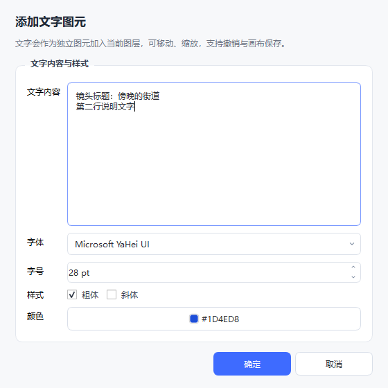

# StoryBoard 画板

一个使用 **Qt 6 / C++17 / CMake** 编写的轻量画板工具，支持自由笔画、图片、文字与常见图形图元、全景查看、图元移动/缩放、图层与层内叠放、图层显示/隐藏与锁定、图形填充样式、画板边缘拉伸与裁剪、背景替换、撤销/重做、模板保存与画板导出。


## 功能

- **画笔模式**：按住左键绘制平滑的自由曲线，可随时选择画笔颜色与粗细。
- **编辑模式**：所有**可见且未锁定**图层上的图元都可以选中、移动、缩放、编辑和删除；勾选“锁定”的图层上的图元不响应点选、框选、拖动、缩放、双击和右键菜单。图元支持框选与多选，`Shift` 等比缩放；选中图元时右侧图层面板会自动选中它所属的图层。右键图元可调整层内高度或跨图层移动。
- **文字图元**：单独的 `T` 文字模式，点击画板放置文字；支持多行、字体、字号、颜色、粗体/斜体；文字与笔画、图片一样可移动、缩放、分层、撤销和保存到模板，编辑模式下双击或右键可再次编辑。
- **常见图形快速插入**：`插入 → 常见图形` 或顶部工具栏图形按钮可快速插入矩形、圆角矩形、椭圆、三角形、菱形、五角星、箭头、双向箭头、直线、左/右大括号、对话气泡共 12 种图形；新图形自动进入当前图层并选中，可直接移动、缩放、调整 `height`/图层、撤销和保存到模板。图形描边颜色与粗细跟随当前画笔设置；填充支持无填充、纯色、斜线、反斜线、交叉线、正交叉线、六边形七种样式与自定义填充色。
- **查看模式（默认）**：进入模式时自动缩放到全部可见图元（全景视图）；只通过视图变换平移/缩放，**不修改图元自身坐标**；`Ctrl+0` / `Home` 一键回到全景。
- **图层**：背景固定为第 0 层；新建图层按创建先后依次变高，低层图元会被高层图元遮盖；右侧图层面板支持新建、删除空图层、上移/下移图层，每行提供显示勾选框与锁定按钮，图层本身支持多选（可批量删除空图层）。选中隐藏图层会自动显示，隐藏当前图层会自动切换到最近的可见图层。
- **层内叠放**：同一图层中的每个图元拥有**唯一**的 `height`，新建图元默认放在该层最高处；`]` / `[` 或右键可 `height +1` / `-1`，`height` 越大越靠上，遇到目标高度已有图元时交换两者高度。
- **背景**：支持纯色、图片（拉伸 / 适应 / 平铺）和清除背景，图片会随模板一起保存。
- **配置**：默认画笔颜色/粗细、画板尺寸、辅助网格、画布外围颜色，使用 `QSettings` 持久化。
- **撤销 / 重做**：添加、删除、移动、缩放、导入图片、添加/编辑文字、插入图形、更换背景、调整画板尺寸、图层增删/排序、图元高度与跨图层移动均可撤销。
- **模板**：保存/打开 `.sbboard` 模板，图片与背景以 PNG 内嵌，文字保存字体与颜色，图形保存类型、描边、填充与线宽；模板菜单会列出模板目录中的最近文件。
- **导出**：导出画板区域或全部图元，支持 PNG、JPEG、PDF，可选输出比例；不会导出网格和选中框。

## 本机验证环境

| 项目 | 版本 / 路径 |
| --- | --- |
| 操作系统 | Windows 11 23H2（10.0.22631） |
| Qt | 6.12.0 `mingw_64`（`D:\Qt\6.12.0\mingw_64`） |
| 编译器 | MinGW-w64 GCC 13.1.0（`D:\Qt\Tools\mingw1310_64`） |
| CMake | 3.30.5 |
| 构建生成器 | MinGW Makefiles（本机未安装 Ninja） |

> 理论上 Qt 6.5+ / MinGW 或 MSVC 也可构建，但本项目在当前环境按上述组合完成编译和自检。

## 构建与运行

### 一键脚本（推荐）

```powershell
powershell -ExecutionPolicy Bypass -File .\scripts\build.ps1
powershell -ExecutionPolicy Bypass -File .\scripts\run.ps1
```

脚本会自动查找 `D:\Qt\6.*\mingw_64` 和对应的 MinGW 工具链，生成到 `build\bin\StoryBoard.exe`，并在 Release 构建后调用 `windeployqt` 部署 Qt 运行库。

常用参数：

```powershell
# 清理后重新构建
powershell -ExecutionPolicy Bypass -File .\scripts\build.ps1 -Clean

# Debug 构建
powershell -ExecutionPolicy Bypass -File .\scripts\build.ps1 -Config Debug

# 指定 Qt 路径
powershell -ExecutionPolicy Bypass -File .\scripts\build.ps1 -QtDir "D:\Qt\6.12.0\mingw_64"

# 只构建，不部署运行库
powershell -ExecutionPolicy Bypass -File .\scripts\build.ps1 -NoDeploy

# 传参数给应用
powershell -ExecutionPolicy Bypass -File .\scripts\run.ps1 .\examples\demo-storyboard.sbboard
```

### 手动 CMake

```powershell
$env:Path = "D:\Qt\Tools\mingw1310_64\bin;D:\Qt\6.12.0\mingw_64\bin;$env:Path"

cmake -S . -B build -G "MinGW Makefiles" `
  -DCMAKE_BUILD_TYPE=Release `
  -DCMAKE_PREFIX_PATH=D:/Qt/6.12.0/mingw_64

cmake --build build -j
cmake --build build --target deploy   # 可选：windeployqt + offscreen 插件
```

### 在 Qt Creator 中打开

直接用 Qt Creator 打开根目录的 `CMakeLists.txt`，选择 `Desktop Qt 6.12.0 MinGW 64-bit` 套件即可；构建目录建议使用 `build` 之外的目录，避免与脚本构建产物冲突。

## 操作说明

### 四种模式

| 模式 | 快捷键 | 说明 |
| --- | --- | --- |
| 查看模式 | `V` | 默认模式。左键拖拽平移，滚轮缩放；切换到此模式会自动全景显示所有图元。视图变换不改变图元坐标。 |
| 编辑模式 | `E` | 左键选择/拖动图元，拖动八个控制点缩放；空白处拖动框选；`Shift` 等比缩放；`Delete` 删除。双击文字可编辑。 |
| 画笔模式 | `B` | 左键绘制自由曲线，工具栏选择颜色/粗细；空格键或中键平移。 |
| 文字模式 | `T` | 点击画板任意位置，在弹出对话框中输入文字并设置字体/字号/颜色；确定后自动切回编辑模式并选中新文字。 |



### 插入常见图形

- 入口：顶部工具栏的图形按钮，或菜单 **插入 → 常见图形**。
- 支持 12 种：矩形、圆角矩形、椭圆、三角形、菱形、五角星、箭头、双向箭头、直线、左大括号、右大括号、对话气泡。其中“椭圆”插入时就是标准圆形，在编辑模式拖动控制点可拉伸成椭圆。


- 选择图形后会立即插入到当前视图中心附近的画板位置，自动切到编辑模式并选中，可马上拖动、用 8 个控制点缩放。
- 图形使用当前画笔颜色描边，矩形、椭圆、三角形等封闭图形按画笔粗细描边；填充样式有无填充、纯色、斜线、反斜线、交叉线、正交叉线、六边形七档，可在工具栏填充按钮或 `样式` 菜单切换，并可另选填充色（默认沿用画笔色的半透明）。箭头使用单色实心轮廓，直线和大括号按画笔粗细绘制。
- 新图形进入当前图层，并自动获得该层唯一 `height`；右键菜单同样支持调整高度、跨图层移动和删除。
- 插入操作进入撤销栈，保存模板时记录图形类型与样式。

### 快捷键

| 操作 | 快捷键 |
| --- | --- |
| 新建画板 | `Ctrl+N` |
| 打开模板 | `Ctrl+O` |
| 保存模板 / 另存为 | `Ctrl+S` / `Ctrl+Shift+S` |
| 导入图片 | `Ctrl+I` |
| 导出画板 | `Ctrl+E` |
| 撤销 / 重做 | `Ctrl+Z` / `Ctrl+Y`（也支持 `Ctrl+Shift+Z`） |
| 全选 / 删除 | `Ctrl+A` / `Delete` |
| 查看 / 画笔 / 编辑 / 文字模式 | `V` / `B` / `E` / `T` |
| 回到全景视图 | `Ctrl+0` / `Home` |
| 放大 / 缩小 / 实际大小 | `Ctrl+=` / `Ctrl+-` / `Ctrl+1` |
| 设置 | `Ctrl+,` |
| 取消当前笔画 | `Esc` |

### 编辑模式细节

- 选中单个图元后，四角与四边共 8 个控制点可缩放图元；拖动角点时按住 `Shift` 保持宽高比。
- 选中多个图元后拖动其中任意一个，所有选中图元一起移动。
- 框选使用与图元形状相交的判定；笔画按曲线附近的命中区域选择，而不是整块矩形。
- 图片、文字、图形图元同样支持移动与缩放；文字缩放会同时缩放字号和行距，图形缩放会改变几何轮廓但保持线宽。
- 双击文字图元，或在右键菜单选择 `编辑文字…`，可以修改内容、字体、字号、颜色与粗斜体。
- 右键图元：`高度 +1` / `高度 -1` 调整同层叠放；`移到上一层图层` / `移到下一层图层` 调整所属图层；`删除图元`。文字图元额外显示 `编辑文字…`。多选时这些操作批量作用于全部选中图元。
- 选中图元后按 `]` / `[` 可快速调整高度 ±1；多选批量执行，只生成一条撤销记录。

### 图层与叠放

- **第 0 层固定为背景**，不能接收图元，也不能删除或上移。
- 用户图层在图层面板中按**上层在前**显示。新建图层总是放在最上层，并自动成为当前图层；新笔画、新导入图片、新文字、新图形都会进入当前图层。
- 图层上移/下移只交换图层顺序，不改变图元坐标；下层图元整体被上层图元遮盖。
- 同一图层内按 `height` 从小到大绘制，`height` 大的图元遮盖 `height` 小的图元。新建图元自动取 `该层最大 height + 1`。
- **同一图层内每个图元的 `height` 唯一**。新建、导入、添加文字、插入图形、跨图层移动都会分配唯一值；载入手工修改过、含重复 `height` 的模板时，会按原顺序自动修复为连续且唯一的值。
- 右键 `高度 +1` / `-1` 每次改变 1；若目标高度已有图元，则交换两者的 `height`，保证点击后立即跨过相邻图元且层内高度保持唯一。
- **叠放优先级**：图层越高优先级越高；同一图层内 `height` 越大优先级越高。高优先级图元会遮盖低优先级图元。
- **完全遮盖**：只有高优先级图元是**纯色填充**（含半透明纯色）时才会完整遮挡下层——图形轮廓内部下层颜色（包括下层的纹理线条）整个不画，只显示上层填充色与背景，不叠出混合色。无填充、斜线/反斜线/交叉线/正交叉线/六边形等纹理填充的图元不遮挡下层，下层颜色与轮廓照常可见（查看模式也一样）；箭头按实心轮廓遮挡，直线、大括号按笔画遮挡，文字按字形、笔迹按笔宽遮挡。
- **查看模式下完全遮盖**：被纯色填充图元遮住的图元不显示任何痕迹；**非查看模式（编辑/画笔/文字）下**，只要有任意面积被更高优先级的纯色填充图元盖住，被盖住的部分同样不画下层颜色，但该非隐藏图元会保留一圈“白色柔光 + 深色虚线”的轮廓，方便看出下面还有东西。导出与查看模式不画这圈提示线；无填充/纹理填充的上层不会触发这圈提示。
- **重叠区域优先命中已选图层**：点击多个图元重叠的位置时，优先选中图层面板中已选图层里的图元；同一图层内仍取最高的那个。
- 跨图层移动时，图元放到目标图层的最上面。图层增删、排序与高度调整都支持撤销与重做。

#### 显示/隐藏与编辑锁定

- 图层面板每行左侧有勾选框：勾选表示显示，取消勾选表示隐藏；背景第 0 层也可以单独隐藏。
- 每行右侧有锁形按钮：按下即锁定该图层，再按一次解锁；背景层不支持锁定。
- **编辑权限由“可见 + 未锁定”决定**：编辑模式下，可见且未锁定图层上的图元都可以被点选、框选、拖动、缩放、双击编辑和右键修改；锁定或隐藏图层上的图元不响应这些操作，右键时会提示先在面板解锁或显示图层。
- 新图元（笔画、图片、文字、图形）始终进入**当前图层**；当前图层只决定新图元的归属，不再限制其他图层的编辑权限。
- 图层与图元都支持多选：`Ctrl`/`Shift` 点选图层面板可多选，批量删除针对选中的空图层；画板内框选或 `Ctrl` 点选可多选图元，选中图元时面板会自动选中它所属的图层。
- **选中的图层自动显示**：在面板中选择一个隐藏图层时，它会立即变为可见并成为当前图层。
- **隐藏当前图层**时，会自动切换到最近的另一个可见用户图层；最后一个可见用户图层不能被隐藏。
- 隐藏图层不会参与全景视图的内容范围，也不会出现在导出结果中；显示/隐藏与锁定状态都会随模板保存。
- 图层显示/锁定状态属于查看状态，不进入撤销栈；图层增删/排序、图元编辑等仍可撤销。
- **选中的图层在面板中有明确高亮**：浅蓝底色 + 左侧蓝色强调条；多选时所有选中图层同时高亮。


### 背景与配置

- **画板 → 替换背景图片…**：选择图片作为背景，支持拉伸、适应、平铺三种填充方式。
- **画板 → 设置背景颜色…** / **清除背景**：纯色背景或恢复白色。
- **画板 → 设置…**：默认画笔颜色/粗细、画板尺寸、辅助网格、画布外围颜色，以及**界面语言**。
- 修改画板尺寸不会移动已有图元，并且可以撤销。

### 界面语言

- 支持**简体中文 / English** 两套界面，默认**跟随系统语言**：系统语言为中文时用中文，其他系统一律用英文。
- **画板 → 设置… → 界面语言** 可以选「跟随系统 / 简体中文 / English」，**保存后当前窗口立即切换**，不需要重启；选择优先写入 `QSettings`（`ui/language`），如果当前系统/环境不允许写注册表或 AppData，会自动退到纯文本文件 `StoryBoard-language.txt`（依次尝试 `AppConfigLocation`、`AppDataLocation`、程序目录），下次启动沿用。选择同时会记在进程内，因此即使持久化失败，本次运行也会立刻切换。
- 用环境变量 `STORYBOARD_LANG=zh` / `en` 可临时覆盖界面语言（用于截图和排查，不写入设置）。
- 菜单、工具栏、状态栏、图层面板、设置/文字/导出/关于等对话框的文案都会翻译；**用户自己的内容不翻译**：图层名（含默认的「背景」「图层 1」）、画板里的文字、模板文件名保持原样。
- 实现方式遵循 **Qt 官方 i18n 流水线**：源码里的中文原文作为翻译源，英文词条维护在 `translations/storyboard_en.ts`，构建时由 `lrelease` 生成 `storyboard_en.qm` 并嵌入资源，运行时由 `QTranslator` 装载（`src/I18n.cpp`）。新增语种只要添加对应的 `.ts`、加进 `CMakeLists.txt` 的 `STORYBOARD_TS_FILES`，在设置里增加选项即可；已经创建好的控件由 `uiRetranslateWidgetTree()` 原地重译，动态拼接的文字（形状菜单、图层行、模式徽标、状态栏等）在 `MainWindow::applyUiLanguage()` 里重建。

### 画板尺寸与边缘

- 编辑模式下，画板四边与四角共 8 个手柄；鼠标靠近边缘时指针会变成双向箭头，拖动即可拉大或裁剪画板。
- 向外拖动扩大画板；向内拖动裁剪画板，最小边长 200，最大 12000。
- 画板原点可以为负坐标，模板会以 `board.x` / `board.y` / `board.width` / `board.height` 保存。
- 缩小画板**不会删除**越界图元：它们仍保留在板外，可随时拖回画板内，也可再次拉大画板恢复可见范围。
- 每次拖动结束生成一条“调整画板尺寸”撤销记录；也可在 `画板 → 设置…` 中直接输入宽高。

### 模板与示例

- 保存路径默认为 `%APPDATA%\ZoneTong\StoryBoard\templates`，可在设置中打开该目录。
- 模板菜单会列出模板目录中的 `.sbboard` 文件，可直接打开。
- 示例模板：[examples/demo-storyboard.sbboard](examples/demo-storyboard.sbboard)
- 示例画板效果：


模板是 UTF-8 JSON，图片图元和图片背景都会转成 PNG 后以 Base64 内嵌，文字以普通字段保存，因此单个模板即可独立分发。

- `version: 2` 起增加 `layers`、`activeLayer`，每个图元记录 `layer` 与 `height`。
- `board` 保存 `x`、`y`（缺省 0）、`width`、`height`，因此画板可以向负坐标方向拉伸。
- `layers` 从低到高排列，`id: 0` 固定为背景；背景不参与 `items`。每个图层保存 `visible` 与 `locked`（缺省未锁定）。
- 图元最终绘制顺序由 `图层顺序 + height` 推导，JSON 中的 `z` 仅用于可读性与旧版兼容。
- `height` 在每层内唯一；读取模板时如果发现重复，会保留原有顺序并重新编号。
- 文字图元类型为 `text`，额外保存 `text`、`fontFamily`、`fontSize`、`fontWeight`、`italic`、`color`、`baseWidth/baseHeight`。
- 图形图元类型为 `shape`，额外保存 `shapeType`、`strokeColor`、`fillColor`、`strokeWidth`、`fillStyle`（`none`/`solid`/`hachure`/`cross_hatch`，缺省按 `fillColor` 透明度推断）；`shapeType` 支持 `rectangle`、`rounded_rectangle`、`ellipse`、`triangle`、`diamond`、`star`、`arrow`、`double_arrow`、`line`、`brace_left`、`brace_right`、`callout`。
- 打开 `version: 1` 的旧模板时，会按原全局 `z` 顺序放入第 1 层，并转换为递增的 `height`。

字段示例：

```json
{
  "format": "StoryBoard",
  "version": 2,
  "board": { "x": 0, "y": 0, "width": 1920, "height": 1080 },
  "background": { "type": "color", "color": "#fff7f3ea" },
  "layers": [
    { "id": 0, "name": "背景", "visible": true, "locked": false },
    { "id": 1, "name": "图层 1", "visible": false, "locked": true },
    { "id": 2, "name": "标注", "visible": true, "locked": false }
  ],
  "activeLayer": 2,
  "items": [
    {
      "type": "stroke",
      "x": 100, "y": 120, "w": 240, "h": 90,
      "layer": 1, "height": 1, "z": 1000001,
      "color": "#ffef4444", "width": 6,
      "points": [[12.5, 13.0], [18.0, 20.5]]
    },
    {
      "type": "image",
      "x": 300, "y": 200, "w": 320, "h": 200,
      "layer": 2, "height": 1, "z": 2000001,
      "name": "shot-01.png",
      "image": "<base64 PNG>"
    },
    {
      "type": "text",
      "x": 80, "y": 70, "w": 520, "h": 90,
      "layer": 2, "height": 2, "z": 2000002,
      "text": "第一行标题\n第二行文字",
      "fontFamily": "Microsoft YaHei UI",
      "fontSize": 36, "fontWeight": 700, "italic": false,
      "color": "#ff1d4ed8",
      "baseWidth": 520, "baseHeight": 90
    },
    {
      "type": "shape",
      "x": 520, "y": 520, "w": 340, "h": 120,
      "layer": 2, "height": 3, "z": 2000003,
      "shapeType": "arrow",
      "strokeColor": "#ffea580c",
      "fillColor": "#00000000", "fillStyle": "none",
      "strokeWidth": 5
    }
  ]
}
```

### 导出

- **范围**：画板区域（固定画板尺寸）或全部图元（内容外接矩形加边距）。
- **格式**：PNG / JPEG / PDF。
- **比例**：0.25× ~ 4×，导出尺寸会实时估算。
- 导出内容包含背景和所有可见图层图元，隐藏图层不会导出；不包含编辑网格、选中框与手柄。

## 自检

项目内置一个不依赖 GUI 桌面的自检入口，覆盖图元增删、移动、缩放、背景、图层顺序、图层面板按钮与勾选框/锁定按钮、图层显示/隐藏、当前图层自动显示与自动切换、锁定图层图元禁止编辑、隐藏图层渲染/内容范围/导出排除、层内 `height` 唯一性与叠放、跨图层移动、图层及高度的撤销/重做、叠放优先级与被遮盖图元轮廓提示（含纯色填充完全不透的像素级验证、无填充与纹理填充不遮挡下层的验证，以及真实视图截图验证）、文字图元创建/编辑/字体颜色/渲染/模板序列化、12 种常见图形的路径/图标/渲染/移动缩放/模板序列化、椭圆默认正圆与拉伸、七种图形填充样式（含交叉线均匀覆盖、反斜线方向、正交叉线双方向、六边形格子结构）与可撤销/模板序列化、图形快速插入菜单与填充菜单项、图层选中高亮与重叠命中优先级、批量高度调整、画板边缘手柄拖动/裁剪及原点序列化、选中控制点的命中区域、粗描边图形的命中区域、背景图片按内容去重、设置对话框颜色持久化、重复 `height` 模板修复、旧版兼容、PNG/JPEG/PDF 导出，以及真实的鼠标事件交互（绘制、文字模式点击、双击文字编辑、主窗口端到端文字创建与模板打开、模式工具栏顺序、中英文词条/原地切换/设置下拉选择语言、查看模式全景/平移紧跟鼠标不抖动/缩放、编辑模式点选/移动/缩放、锁定图层点选/双击/右键提示）：

```powershell
$env:QT_QPA_PLATFORM = "offscreen"
$report = ".\build\selftest.txt"
Remove-Item $report -ErrorAction SilentlyContinue
.\build\bin\StoryBoard.exe --self-test $report
# 这是 Windows GUI 子系统程序，命令会先返回；等待报告写入后再查看
Start-Sleep -Seconds 8
Get-Content $report
```

当前共 **367 项检查，全部通过**（`SUMMARY 367 passed, 0 failed`）。

> `--self-test` 需要 `platforms\qoffscreen.dll`。`build.ps1` 的部署步骤会一并复制；手动构建时如果只运行窗口程序则不需要它。

其他内部工具参数（开发自检用）：

```powershell
# 渲染示例画板为 PNG（不弹窗，使用 Windows 字体）
.\build\bin\StoryBoard.exe --render-demo .\build\demo.png

# 生成示例模板
.\build\bin\StoryBoard.exe --demo-template .\examples\demo-storyboard.sbboard

# 抓取主界面 / 设置 / 导出 / 文字对话框截图
.\build\bin\StoryBoard.exe --ui-screenshot .\build\ui.png
.\build\bin\StoryBoard.exe --settings-screenshot .\build\settings.png
.\build\bin\StoryBoard.exe --export-screenshot .\build\export.png
.\build\bin\StoryBoard.exe --text-screenshot .\build\text.png

# 抓取常见图形快速插入菜单
.\build\bin\StoryBoard.exe --shape-menu-screenshot .\build\shape-menu.png
```

## 项目结构

```text
StoryBoard/
├─ CMakeLists.txt
├─ src/
│  ├─ main.cpp               入口、全局主题、开发用截图/自检参数
│  ├─ MainWindow.*           菜单、工具栏、模板、导入、导出、设置
│  ├─ BoardScene.*           画板场景、图层/高度模型、背景/网格、模板 JSON、离屏渲染
│  ├─ BoardView.*            四种模式、绘制、文字放置/双击编辑、视图缩放/平移、全景、右键菜单
│  ├─ LayerPanel.*           图层面板：自定义行控件、显示/锁定、多选、新建/删除/上移/下移
│  ├─ BoardItem.*            图元基类：layer/height、选中框、8 个缩放手柄、移动/缩放交互
│  ├─ StrokeItem.*           自由笔画（平滑路径、点、颜色/粗细）
│  ├─ ImageItem.*            图片图元
│  ├─ TextItem.*             文字图元（多行、字体、颜色、缩放、序列化）
│  ├─ ShapeItem.*            12 种常见图形（路径、描边/填充、缩放、序列化、菜单图标）
│  ├─ Commands.*             Undo/Redo 命令
│  ├─ ExportDialog.*         导出设置对话框
│  ├─ SettingsDialog.*       设置对话框
│  ├─ TextDialog.*           添加/编辑文字对话框
│  ├─ Settings.*             QSettings 配置
│  ├─ I18n.*                 语言设置、QTranslator 装载、界面原地重译
│  ├─ IconFactory.*          用 QPainter 绘制的界面图标
│  └─ SelfTest.*             自检与示例画板生成
├─ resources/                应用图标、下拉箭头、qrc、rc
├─ translations/             Qt 翻译源文件（storyboard_en.ts）
├─ scripts/                  build.ps1 / run.ps1
├─ examples/                 示例模板
└─ docs/                     README 截图
```

## 实现要点

- **场景 / 视图分离**：图元只保存在场景坐标中。查看模式的缩放、平移全部作用于 `QGraphicsView` 的视口变换，图元 `pos()`、尺寸和内部路径都不改变。
- **自定义图元交互**：`BoardItem` 统一实现移动、八个控制点缩放、多选联动，拖动结束才生成 `GeometryCommand`；撤销时恢复位置与尺寸。
- **平滑笔画**：绘制时按距离采样，使用二次贝塞尔曲线平滑；笔宽、颜色随图元保存。笔画命中检测使用描边后的路径，而非包围盒。
- **图层与绘制顺序**：`QGraphicsItem::zValue` 由 `图层序号 × 1000000 + height` 统一推导，场景负责在图层或高度变化后重新计算，图元自身不保存重复的绘制顺序状态。背景由 `BoardScene::drawBackground` 绘制，始终位于所有图元下方，等价于固定的第 0 层。
- **图层可见性与编辑锁定**：`BoardLayer` 保存 `visible` 与 `locked`，场景在图层、锁定状态或模式变化时统一调用 `updateItemFlags()`：隐藏图层图元 `setVisible(false)`；“编辑模式 + 所在图层可见 + 未锁定”的图元才可选中和 hover，当前图层只决定新图元归属。锁定状态刻意不进入撤销栈，`applyLayerStateInternal()` 会用同 id 的旧快照把 `locked` 回填，避免撤销图层操作时偷偷解锁；从模板载入时改为保留文件里的锁定状态。隐藏图元同时从 `contentRect()`、全景和导出渲染中消失。
- **层内高度**：新建图元取当前层最大 `height + 1`；`高度 +1/-1` 遇到同高度图元时交换两者高度；场景在添加、跨层移动、图层重排和模板载入时统一校验并修复 `height`，保证同一图层内每个 `height` 只出现一次。
- **文字图元**：保存文字、`QFont` 与颜色，使用 `QFontMetricsF` 计算多行文字的自然尺寸；绘制时以图元内容尺寸与自然尺寸的比例缩放文字，因此拖动控制点会同步缩放字号与行距。编辑文字通过 `TextItemCommand` 记录修改前后的文字、字体、颜色、位置与尺寸。
- **常见图形**：`ShapeItem` 用 `QPainterPath` 描述矩形、圆角矩形、椭圆、三角形、菱形、五角星、单向/双向箭头、直线、左右大括号和对话气泡；缩放只改变图形包围盒，线宽保持不变。箭头、对话气泡等按填充轮廓绘制，直线和大括号按描边路径绘制；模板保存 `shapeType/strokeColor/fillColor/strokeWidth/fillStyle`。填充样式为“无/纯色/斜线/反斜线/交叉线/正交叉线/六边形”；纹理类填充共用一套 `patternCenterLines()` 几何，斜线与反斜线是 45° 的两个方向，正交叉线是水平+竖直的正交网格，六边形填充是错行排布的尖顶六边形，绘制时统一裁到图形路径内，`ShapeStyleCommand` 记录批量填充修改前后的状态。遮挡判断用 `paintedShape()`：图形只有在 `FillStyle::Solid` 且填充色 `alpha > 0` 时才把整个轮廓算作遮挡区（箭头始终按实心轮廓），无填充/纹理填充只算描边那一圈；这样纹理样式压在下层图形上时，下层颜色与轮廓仍然看得见。
- **不透遮挡与视图绘制路径**：遮挡裁剪写在 `BoardScene::drawItems()` 里，但 `QGraphicsView` 默认直接用 `QGraphicsScenePrivate::drawItems` 画图元、不会调用这个虚函数，因此 `BoardView` 打开了 `IndirectPainting`，让真实视图也走 `QGraphicsScene::drawItems`（画面重叠处才不会叠出混合色）；导出与自检用的 `QGraphicsScene::render` 本来就走该虚函数。另外视图绘制时画笔上一般不设置裁剪，此时 `QPainter::clipBoundingRect()` 返回的是空矩形而不是整块设备，`drawItems()` 需要在这种情况下用设备尺寸换算回场景坐标作为可见区，否则会把所有图元判成“被完全遮住”而整屏空白。**图元自己的 `paint()` 里如果需要裁剪（纹理填充、文字），必须用 `Qt::IntersectClip`**：`setClipPath`/`setClipRect` 默认是 ReplaceClip，会把 `drawItems()` 设置的遮挡裁剪整个顶掉，导致纹理线条或文字画到本该被上层纯色遮住的位置。
- **背景绘制**：`QGraphicsView` 负责画布外围颜色，`BoardScene::drawBackground` 负责画板背景和网格；这样既能保留深色画布工作区，也能让导出内容只包含画板本身。
- **画板边界**：`BoardScene` 用 `QRectF` 表示画板（原点可为负）；`BoardView` 在编辑模式下靠近边缘时显示 8 个手柄，拖动按边/角调整矩形并做 200–12000 的钳制，松手后 `BoardSizeCommand` 记录一整次尺寸变化；缩小时越界图元保留不删。
- **模板**：JSON + Base64 PNG，保存画板 `x/y/width/height`、图层顺序、锁定状态、当前图层以及每个图元的 `layer/height`；文字图元直接保存文字与字体字段；兼容旧版仅含 `z` 的模板；载入时修复重复 `height`；未知图元类型会被拒绝，避免半加载。
- **撤销栈**：`QUndoStack` 上限 300 步；图层顺序、图层增删、层内高度、跨图层移动、文字编辑均通过命令记录；新建/打开模板时先清理命令再清理图元，避免悬空引用。主窗口析构时会先清空撤销栈并断开视图与场景，避免 `QUndoStack` 在场景销毁后触发界面刷新。

## 已知限制

- 当前图元类型为自由笔画、图片、文字与 12 种常见图形，尚未提供旋转、分组功能；文字暂不支持富文本（同一图元内混排不同字号/颜色）。
- 图形描边始终跟随当前画笔设置；已插入图形可批量切换填充样式与填充色，但暂不支持逐图元独立设置描边色/线宽、虚线与旋转。
- 图层删除仅支持空图层；图层重命名和拖拽排序尚未提供，可用面板按钮上移/下移。
- 模板内嵌图片，包含大图时 `.sbboard` 文件会相应变大。
- 撤销历史上限 300 步；删除的图元在文档重置前会保留在内存中以便重做。
- 仅在当前 Windows 11 + MinGW 环境验证；其他平台需自行准备 Qt 6 构建环境。
