# 图形类拆分与编辑面板 · 总变更方案（v12）

- 基线：`origin/main` @ `842c765`（v0.1.4），本地主干已快进
- 自检基线：997 条（`scripts/package-portable.sh:165`）
- 形态：单任务，按项目规则直接在主干目录开发，分切片提交；合并前不编译，合并时统一编译、自检、部署
- 约束：新 `.cpp` cloc < 500，提交前 clang-format；`storyboard_zh.ts` 手工维护，禁止跑 lupdate

## 0. 已锁定的决定

1. 面板行显隐按**交集**：选中图元属性集合的交集决定各行显隐。
2. `Star4 / Hexagram / Heart / FlagWave / Scroll` **脱离** `PolygonItem` 插入，各成图元类；多边形只保留布尔运算产物。
3. 面板改名：中文“编辑面板”，英文源串 `Edit panel`；对象名与类名同步迁移。
4. `ImageItem` 彻底删除：源码零引用，插入图片＝矩形图元＋填充图片＋画布 `images` 表（`src/ImportExportController.cpp:411-417`）；本轮只剩翻译残留清理。
5. **线条类派生重排**：现 `LineItem`（直线）更名为 `StraightLineItem`；`StraightLineItem / ArcItem / SineItem` 不再继承 `CurveItem`；从现有四类（`CurveItem` 及其三个子类）剥离描线属性与描带几何，新建抽象类 `LineItemAbstract`(新)，`StraightLineItem / ArcItem / SineItem / CurveItem / BraceItem` 五类共同继承它。
6. **类型标识下沉到子类**：新 `LineItemAbstract` 是抽象类，不覆写 `kind()`；`straightline / arc / sine / freehand / brace` 五个形态各自返回自己的类型名，`baseJson()` 写 `"kind": kind()`（JSON 键与函数同名，不再有 `type` 键）。没有旧画布，不设 `storageKind()` 之类的兼容层，`curveKind` 键与 `CurveKind` 枚举一并删除。
7. **花括号自建类**：花括号不再寄生在 `CurveItem` + `CurveKind::Brace`，独立为 `BraceItem : LineItemAbstract`；`CurveItem` 只剩手绘笔迹/图片线稿，`m_curveKind` 与 `setCurveKind` 随之删除。
8. **矩形派生自平行四边形**：`RectangleItem : ParallelogramItem`，内角锁 90°、无角度句柄、无内角行，但保留 `cornerRadius`（px，0 为直角）；`autoCorner` 与圆角矩形“自适应”预置删除。菱形不再是类型，只作为平行四边形的 90° + 旋转 45° 预置。
9. **平行四边形角度交互**：只保留一个角度句柄（`Apex`，画在左上顶点），拖动连续改内角 5–175°、跨 90° 平滑，拖动时顶点旁显示 0.1° 精度的角度读数；`TopLeft`/`TopRight` 恢复普通缩放。
10. **两个“图片”从命名分家**：图元侧统一 `FillImage`（填充图片），画布层统一 `CanvasBackground`（画布背景图片）；`Background image` 一词不再指代图元填充。
11. **命名遵循华为 C++ 推荐驼峰风格**：类型/函数大驼峰、成员 `m_aaaBbb`、局部与参数小驼峰、全局 `g_aaaBbb`、枚举值与常量全大写；Qt 虚函数覆盖豁免，JSON 键不受约束（见 4.8）。

## 1. 基线盘点

已完成、无需再动：

- `PolygonItem : ShapeItem`（`src/PolygonItem.h:17`），`kind()=="polygon"`，图层样式按层映射。
- 当前曲线族：`CurveItem` 为基类，`LineItem`（直线）、`ArcItem`（`public CurveItem, public EllipseShape` 双基类，`src/ArcItem.h:8`）、`SineItem` 派生；`CurveKind { Freehand, Line, Arc, Sine, Brace }` 作为持久化判别（`src/CurveItem.h:18`）。
- `ShapeType` 只剩 16 个有面积图形（菱形归入平行四边形，矩形保留为派生类）（`src/ShapeItem.h:13-35`）。
- 行序：填充样式 → 填充颜色 → 填充图片 → 描线样式 → 描线颜色 → 描线宽度（`src/ItemDockPanel.cpp:84-109`）。
- 图片：`ImageItem` 与图片属性块、替换命令均已删除。

待改：

| 问题 | 证据 |
|---|---|
| 一个类装 17 种图形，918 行 | `src/ShapeItem.cpp`：默认尺寸 switch `:61-96`，类型分支 `:250,311,355,367,390,403,589,668-676,762-767,891-902` |
| 类型可运行中改变、多边形靠标志位特判 | `src/ShapeItem.h:143-144`、`:131` |
| 描线族以 `CurveItem` 为基类，直线/弧线/正弦只是“曲线子型” | `src/CurveItem.h:13-18`、`src/LineItem.cpp:24-27` |
| 类型强转 96 处（非测试：`dynamic_cast` 91 + `qobject_cast` 5），其中落到图元叶子 56 处 | `ItemDockPanel.cpp` 16、`BoolOps.cpp` 14、`LineSplitOps.cpp` 11、`Commands.cpp` 11、`StyleController.cpp` 7、`ItemPropertiesDialog.cpp` 7、`CurveParamCommand.cpp` 4 等 |
| 卡片可见性仍是并集 | `src/ItemDockPanel.cpp:285-352` |

## 2. 目标派生图

### 2.1 现状（842c765）

```
CanvasItem
├── ShapeItem                      // 17 种 ShapeType + m_type + isPolygon()
│   └── PolygonItem
├── CurveItem                      // 描线状态 + 点段几何 + 拟合/来源/曲线类型
│   ├── LineItem                   // 直线
│   ├── ArcItem (+EllipseShape)
│   └── SineItem
└── TextItem
```

### 2.2 目标

```
CanvasItem
├── ShapeItem (抽象)               // 填充/描线/背景图片/自定义轮廓/绘制管线
│   ├── EllipseItem               // +EllipseShape 基类（多继承）
│   ├── TriangleItem               // bottomAngle1/2, Apex 句柄, 底边刻度
│   ├── StarItem
│   ├── ArrowItem
│   ├── DoubleArrowItem
│   ├── CalloutItem
│   ├── SectorItem                 // startAngle/sweepAngle, 轮廓包围盒；+EllipseShape 基类
│   ├── Star4Item
│   ├── HexagramItem
│   ├── HeartItem
│   ├── FlagWaveItem               // 闭合波形带
│   ├── ScrollItem                 // 闭合卷轴（三块并集）
│   ├── CubeItem                   // 仅旧文件单图元
│   ├── CylinderItem               // 仅旧文件单图元
│   ├── ParallelogramItem          // parallelogramAngle 5–175°，角度读数
│   │   └── RectangleItem           // 内角锁 90°，保留圆角
│   └── PolygonItem                // 布尔运算产物
├── LineItemAbstract (抽象, 新)            // 描线属性 + 点段几何 + 描带/箭头管线
│   ├── StraightLineItem           // 原 LineItem，两点线性
│   ├── ArcItem (+EllipseShape)    // 弧线
│   ├── SineItem                   // 正弦（周期/振幅）
│   ├── CurveItem                  // 手绘笔迹 / 图片线稿（拟合、简化、来源、dot）
│   └── BraceItem                  // 花括号（采样路径 + linearPath，右括号=旋转 180°）
└── TextItem
```



```mermaid
classDiagram
    CanvasItem <|-- ShapeItem
    CanvasItem <|-- LineItemAbstract
    CanvasItem <|-- TextItem

    ShapeItem <|-- EllipseItem
    ShapeItem <|-- TriangleItem
    ShapeItem <|-- StarItem
    ShapeItem <|-- ArrowItem
    ShapeItem <|-- DoubleArrowItem
    ShapeItem <|-- CalloutItem
    ShapeItem <|-- SectorItem
    ShapeItem <|-- Star4Item
    ShapeItem <|-- HexagramItem
    ShapeItem <|-- HeartItem
    ShapeItem <|-- FlagWaveItem
    ShapeItem <|-- ScrollItem
    ShapeItem <|-- CubeItem
    ShapeItem <|-- CylinderItem
    ShapeItem <|-- ParallelogramItem
    ParallelogramItem <|-- RectangleItem
    ShapeItem <|-- PolygonItem

    LineItemAbstract <|-- StraightLineItem
    LineItemAbstract <|-- ArcItem
    LineItemAbstract <|-- SineItem
    LineItemAbstract <|-- CurveItem
    LineItemAbstract <|-- BraceItem
    EllipseShape <|-- EllipseItem : 几何基类（多继承）
    EllipseShape <|-- SectorItem : 几何基类（多继承）
    EllipseShape <|-- ArcItem : 几何基类（多继承）

    class ShapeItem { <<abstract>> +shapeKey() +defaultOutline(rect) +properties() }
    class LineItemAbstract { <<abstract>> +strokeColor() +strokeWidth() +setStrokePoints() +simplifyCurve() }
    class StraightLineItem { +kind()="straightline" }
    class ArcItem { +kind()="arc" }
    class SineItem { +kind()="sine" }
    class CurveItem { +kind()="freehand" +endStroke() +simplifyCurve() +source() }
    class BraceItem { +kind()="brace" +setBraceRect() }
```

`EllipseShape` 不是图元，是只装椭圆/弧/扇形几何的基类（`src/EllipseShape.h:11-41`：`ellipse/arc/sector/arcBounds/sectorBounds/sample/clampedSweep`）。它**被继承，不被组合**：`ArcItem` 已经 `public CurveItem, public EllipseShape` 双基类（`src/ArcItem.h:8`）；`EllipseItem` 与 `SectorItem` 现在尚未派生（`ShapeItem` 走 `ShapePathBuilder.cpp:370` 里临时构造的 `EllipseShape` 局部对象取几何，那是临时借用，不是派生关系），S6 改为 `public ShapeItem, public EllipseShape`。

### 2.3 派生关系

```
CanvasItem（抽象根）
├─ ShapeItem（抽象）
│  ├─ EllipseItem
│  ├─ TriangleItem
│  ├─ StarItem
│  ├─ Star4Item
│  ├─ HexagramItem
│  ├─ HeartItem
│  ├─ CalloutItem
│  ├─ ArrowItem
│  ├─ DoubleArrowItem
│  ├─ FlagWaveItem
│  ├─ ScrollItem
│  ├─ CubeItem
│  ├─ CylinderItem
│  ├─ ParallelogramItem
│  │  └─ RectangleItem（固定 90°）
│  ├─ SectorItem
│  └─ PolygonItem（布尔运算产物）
├─ LineItemAbstract（抽象）
│  ├─ StraightLineItem
│  ├─ ArcItem
│  ├─ SineItem
│  ├─ CurveItem
│  └─ BraceItem
└─ TextItem
```

第二基类只有 `EllipseShape`（几何基类，不在图元树上），三处多继承：`EllipseItem` 与 `SectorItem` 另继承 `ShapeItem`，`ArcItem` 另继承 `LineItemAbstract`。

### 2.4 逐类新增属性与接口

只列该类独有的，父类能力不重复；`*` 为纯虚。接口名按 §4.8.1 的大驼峰规范书写，与现存代码的小驼峰名对应用 §4.8.3 映射。

```
EllipseItem ← ShapeItem + EllipseShape
  属性：无
  接口：currentPath(rect) 改走 EllipseShape::ellipse()

TriangleItem ← ShapeItem
  属性：bottomAngle1、bottomAngle2
  接口：adjustedContentSize()、contentResized()（角度为真相、高度派生）、
        customHandleCenter()（顶点 Apex）、drawSelectionOverlay()（底边刻度）、triangleVertex()

RectangleItem ← ParallelogramItem
  属性：cornerRadius（px，0 为直角）；内角固定 90°，不开放角度属性
  接口：currentPath(rect) 覆写（圆角矩形路径）、customHandleCenter(Apex) 返回空（不画角度句柄）

ParallelogramItem ← ShapeItem
  属性：parallelogramAngle（5–175°，默认 60°）
  接口：currentPath(rect) 覆写、customHandleCenter(Apex)（左上顶点句柄）、drawSelectionOverlay()（句柄与角度读数）

SectorItem ← ShapeItem + EllipseShape
  属性：startAngle、sweepAngle
  接口：frameRect()（sectorBounds）、contentResized()、currentPath(rect) 改走 EllipseShape::sector()

FlagWaveItem ← ShapeItem
  属性：无（路径是 `closeSubpath()` 收尾的闭合波形带）
  接口：defaultOutline(rect) 覆写

ScrollItem ← ShapeItem
  属性：无（路径是左卷筒 + 纸面 + 右卷筒的闭合并集）
  接口：defaultOutline(rect) 覆写

PolygonItem ← ShapeItem
  属性：layers（QList<Layer>{path,fill,stroke,strokeWidth,filled,role}）、designSize
  接口：fillColor/strokeColor/strokeWidth 覆写（从层取值）、shape/currentPath/paintedShape/outlineShape 覆写（层并集）、
        setStyle/setFill/setFillStyle/setStrokeStyle 覆写、state/applyState 覆写；
        静态 pathToJson()/pathFromJson()/closedSubpaths()/mapLayerPath()

其余图形（无新增属性和接口，只实现三个纯虚）
  StarItem、Star4Item、HexagramItem、HeartItem、CalloutItem、
  ArrowItem、DoubleArrowItem、CubeItem、CylinderItem
  → shapeKey()*、defaultContentSize()*、defaultOutline(rect)*

ShapeItem 自身（相对 CanvasItem）
  属性：fillColor、fillStyle、strokeColor、strokeWidth、strokeStyle、opacity(m_opacity)、
        fillImage + fillImageId + fillImageMode、customShape（name/unitPath）
  接口：currentPath(rect)*、shapeKey()*、defaultContentSize()*、defaultOutline(rect)*、
        state()/applyState(ShapeItemState)、setStyle/setFill/setFillStyle/setStrokeStyle、
        setFillImage/clearFillImage/hasFillImage、isCustomShape/customShapePath/setCustomShape
  删除：m_type、setShapeType()、isPolygon()

LineItemAbstract ← CanvasItem（抽象，不覆写 kind()）
  属性：m_strokeColor、m_strokeWidth、m_strokePattern、m_startArrow、m_endArrow、m_segments、m_path、
        m_baseSize、m_strokePadding、m_polyline
  接口：strokeColor()/strokeWidth()/strokePattern()、setStrokeColor/setStrokeWidth/setStrokePattern、startArrow/endArrow/setArrowStyles、
        setStrokePoints()、strokePoints()/segmentCount()、geometryState()/applyGeometryState()、
        outlineShape/paintedShape/shape、paintContent()（缩放画布 + 描带 + 两端箭头）、
        simplifyCurve(tolerance)（默认 false 的能力位）

StraightLineItem ← LineItemAbstract
  属性：无（箭头继承自基类）
  接口：setEndpoints(起点, 终点, 色, 宽)、frameRect() 覆写（选框最小 12×12）

ArcItem ← LineItemAbstract + EllipseShape
  属性：startAngle、sweepAngle、m_relFrame
  接口：setAngles()、setArcGeometry()、rebuild()、frameRect()、toJson()/fromJson() 覆写（角度键）

SineItem ← LineItemAbstract
  属性：Params{cycles 1–12、amplitude px}、m_relFrame
  接口：params()/setParams()、setWaveGeometry()、rebuild()、contentResized() 覆写（竖向拉伸=改振幅）

CurveItem ← LineItemAbstract
  属性：m_rawPoints、m_drawing、m_finished、m_dot、m_source(HandDrawn/LineArt)
  接口：beginStroke()/appendScenePoint()/endStroke()/isEmpty()、source()/setSource()、
        simplifyCurve() 覆写（真实实现）、paintContent() 覆写（补 dot）

BraceItem ← LineItemAbstract
  属性：m_relFrame
  接口：setBraceRect()；几何=采样点 + linearPath（右括号=旋转 180°）

TextItem ← CanvasItem
  属性：m_text、m_font、m_color、m_baseSize
  接口：setTextFormat()、text()/textFont()/textColor()、naturalSize()、静态 measure()、
        state()/applyState(TextItemState)、clippingShape() 覆写（只裁字形）
```

## 3. 线条族重构契约

### 3.1 职责切分

| 归属 | 内容 |
|---|---|
| 新 `LineItemAbstract`（抽象，`src/LineItemAbstract.h/.cpp`） | 描线状态：`m_strokeColor / m_strokeWidth / m_strokePattern / m_startArrow / m_endArrow`；几何载体：`m_segments / m_path / m_baseSize / m_strokePadding / m_polyline`；接口：`strokeColor/strokeWidth/strokePattern/setStrokeColor/setStrokeWidth/setStrokePattern/startArrow/endArrow/setArrowStyles`、`setStrokePoints`、`strokePoints/segmentCount`、`GeometryState geometryState/applyGeometryState`、`outlineShape/paintedShape/shape`、`paintContent`（缩放画布 + 画笔 + 两端箭头）、`virtual bool simplifyCurve(qreal tolerance)`（默认 false）、JSON 公共键（`strokeColor/strokeWidth/strokePattern/baseWidth/baseHeight/startArrow/endArrow/polyline/segments`）。**不覆写 `kind()`**，五个形态各自的类型名由子类给出（见 3.5） |
| `CurveItem`（保留类，只剩笔迹） | 绘制生命周期：`beginStroke/appendScenePoint/endStroke`、`m_rawPoints/m_drawing/m_finished`；拟合与简化：`simplifyCurve`；`m_dot` 与 `dot/dotCenter` JSON；`m_source`（HandDrawn/LineArt）；`displayName`“曲线”；`paintContent` 覆写以补 dot；覆写 `simplifyCurve` 提供真实实现。删除 `m_curveKind` 与 `setCurveKind` |
| `StraightLineItem`（原 `LineItem` 改名） | `setEndpoints`、`frameRect` 最小 12×12、`linear=true`、`displayName`（带箭头时源串 `Line Arrow`，否则 `Straight Line`）、`typeDisplayName()`＝`Straight Line` |
| `ArcItem` | `startAngle/sweepAngle`、`m_relFrame`、`rebuild()`（改调基类 `setStrokePoints`）、`frameRect`、角度 JSON、`typeDisplayName()`＝弧线 |
| `SineItem` | `cycles/amplitude`、`m_relFrame`、`rebuild()`、拉伸反推振幅、参数 JSON、`typeDisplayName()`＝正弦 |
| `BraceItem`（新，`src/BraceItem.h/.cpp`） | `setBraceRect(const QRectF&, color, width)`：内部按 `ShapePathBuilder::bracePath`（`src/ShapePathBuilder.cpp:320`）采样 64 段后调基类 `setStrokePoints(..., linear=true)`，不再由插入端自己拼点；默认尺寸 42×128；右括号＝`setRotationAngle(180)`；`displayName/typeDisplayName`＝花括号 |

`CurveKind` 枚举与 `m_curveKind / setCurveKind` 全部删除——类型名由各类 `kind()` 承担，花括号已独立成类，`CurveItem` 只剩手绘与线稿提取。

### 3.2 序列化：直接写自身类型名

不存在旧画布，不做兼容层，`curveKind` 也不再保留。**类型标识只留一套**：函数 `kind()` 负责给出字符串，JSON 键同名用 `kind`，不再有 `type`：

- `baseJson()` 写 `"kind": kind()`（`src/CanvasItem.cpp:321` 把键名从 `type` 改成 `kind`），五个子型分别写成 `"straightline" / "arc" / "sine" / "freehand" / "brace"`。函数名、键名、取值三者一一对应，没有第二套映射。
- 删 `type` 键后，凡读图元类型的地方都改读 `kind`：`src/DocumentController.cpp:119,242`、`src/scene/CanvasSceneSerialization.cpp:171`、`src/CustomShapeTemplates.cpp:91`、`src/ExcalidrawFormat.cpp:533`、`src/scene/CanvasSceneItemLifecycle.cpp:266-267`（工厂）。`PolygonItem::toJson()` 里那条重复的 `"kind"` 键（`src/PolygonItemJson.cpp:73`）随之删除，不再需要。
- 不动的 `type`：`background` 描述对象（`CanvasSceneSerialization.cpp:63-70,207`）与 Excalidraw 元素/根对象的 `type`（`ExcalidrawFormat.cpp` 的导入导出、`DocumentController.cpp:59` 读的 `elements`）属于别的结构或外部格式，保留原名。
- 为什么不用 `type` 这个名字：`QGraphicsItem::type()` 已被 Qt 占用且是 `int` 返回的虚函数，`CanvasItem` 现在就在覆写它（`src/CanvasItem.h:38` 的 `int type() const override { return Type; }`），C++ 不允许仅靠返回类型区分同参重载，`QString type() const` 无法与之共存。字符串标识只能另起名，于是函数、JSON 键、取值统一到 `kind`。
- `CurveKind` 枚举、`curveKind()` 虚函数、`curveKindToString/curveKindFromString`、`setCurveKind` 全部删除（`CurveKind` 共 52 处引用，JSON `curveKind` 键 8 处）。
- `createItemForJson` 不再“先看 type 再看 curveKind”，退化成一次按 `kind` 建类：`straightline` → `StraightLineItem`、`arc` → `ArcItem`、`sine` → `SineItem`、`freehand` → `CurveItem`、`brace` → `BraceItem`，其余仍在 `createItem()` 里按 `shape` / `polygon` / `text` 建；未知 `kind` 返回空指针，由 `DocumentController` 拒载。
- 互转适配点两个：`src/ExcalidrawFormat.cpp:238-260` 导入时按 Excalidraw 的 `line/arrow/freedraw` 直接给出 `kind:"straightline"` 或 `"freehand"`（外部 `type:"line"` 与本项目 `kind:"straightline"` 是两个命名空间，不要照抄）；`:608-614` 导出分支由 `kind=="curve"` 改成按五个 `kind` 分派，`:541` 的 `shapeType=="line"` 死分支删除。

### 3.3 强转口径：不得落到用户定义的叶子类

“强转”不只指 `dynamic_cast`：`static_cast`、`reinterpret_cast`、C 风格 `(T*)`、`qobject_cast` 同等适用。约束范围是图元派生树，规则三条：

- 目标可以是**抽象基类**：`LineItemAbstract*`、`ShapeItem*`、`EllipseShape*`。
- 目标可以是 **Qt 原生类**：`QGraphicsItem*`、`QWidget*`、`QObject*`、`QMessageBox*`、`QToolButton*` 等，不受限制。
- 目标不得是**用户定义的具体图元类**（叶子）：`StraightLineItem / ArcItem / SineItem / CurveItem / BraceItem / TextItem / PolygonItem` 与 16 个图形类。

现状（非测试）：强转 96 处 = `dynamic_cast` 91 + `qobject_cast` 5。其中落到图元叶子 56 处（`CurveItem` 25、`PolygonItem` 12、`TextItem` 9、`ArcItem` 5、`SineItem` 5）；`ShapeItem` 37 处本就是抽象基类，保留；`qobject_cast` 5 处里 3 处是 Qt 原生类（`QMessageBox`、`QToolButton` ×2）。

| 判断目的 | 替换方式 |
|---|---|
| 是否描线图元 | `dynamic_cast<LineItemAbstract*>`（抽象） |
| 是否带填充/描线的图形 | `dynamic_cast<ShapeItem*>`（抽象，S6 后） |
| 是否椭圆系几何（椭圆 / 扇形 / 弧线） | `dynamic_cast<EllipseShape*>`（几何基类） |
| 具体是哪一类（弧线 / 正弦 / 花括号 / 文字 / 多边形） | `kind()` 比较，不再强转 |
| 需要某类的专属能力（角度、波形、文字内容） | 在 `LineItemAbstract` / `CanvasItem` 上开虚函数或能力位，或按 `properties()` 判断 |

`CurveParamCommand` 里 `dynamic_cast<ArcItem*>` / `dynamic_cast<SineItem*>`（`src/CurveParamCommand.cpp:29-35`）改为在 `LineItemAbstract` 上开 `paramState()/applyParamState()`，由 `ArcItem`、`SineItem` 各自覆写。

简化命令按能力位实现：`LineItemAbstract::simplifyCurve(qreal)` 为虚函数，基类默认 `return false`，只有 `CurveItem` 覆写真实实现；`CanvasScene` 遍历 `LineItemAbstract*` 直接调虚函数（`src/scene/CanvasSceneItems.cpp:108` 的 `smoothStroke(...)` 换成同名新接口），于是只在手绘/线稿上生效，全程零强转。

豁免两处（非图元类，Qt 对象模型惯用法）：`src/CanvasItem.cpp:51` 的 `qobject_cast<CanvasScene*>`（`CanvasScene` 是图元宿主，`canvasScene()` 是图元访问场景的唯一入口）、`src/LayerPanelView.cpp:51` 的 `qobject_cast<LayerRow*>`（列表项控件）。两者虽无子类，但不在图元派生树内，规则不覆盖；若要严格执行，得给 `CanvasItem` 增一个非虚的宿主指针，代价不值。

### 3.4 线条族在属性表里的形态

`LineItemAbstract` 追加描线三件套；`StraightLineItem`、`SineItem`、`CurveItem`、`BraceItem` 追加 `ArrowStart/ArrowEnd`——箭头行对全部描线子型开放，花括号也有（现状即如此，`src/ItemDockPanel.cpp:307-315`、`src/ItemPropertiesDialogStyleBlock.cpp:322-323`），不做实例级扣减；`ArcItem` 追加 `StartAngle/SweepAngle`；`SineItem` 另有 `SineCycles/SineAmplitude`。

### 3.5 类型标识

`kind()` 是唯一类型标识，进程内判断与文件 `kind` 键共用一份，不再有第二套映射。`typeDisplayName()` 只负责人类可读称呼（自动命名、属性窗标题），不参与任何逻辑：

| 类 | `kind()` | `typeDisplayName()`（英文源串 → 中文） |
|---|---|---|
| 抽象 `LineItemAbstract` | —（不实例化） | `Line` → 线条（族名与文档术语，不出现在图元列表里） |
| `StraightLineItem` | `"straightline"` | `Straight Line` → 直线（`displayName()` 带箭头时给 `Line Arrow` → 直线箭头） |
| `ArcItem` | `"arc"` | `Arc` → 弧线 |
| `SineItem` | `"sine"` | `Sine wave` → 正弦 |
| `CurveItem` | `"freehand"` | `Curve` → 曲线 |
| `BraceItem` | `"brace"` | `Brace` → 花括号（新增翻译条目） |

- 抽象基类在方案里暂名 `LineItemAbstract`（`src/LineItemAbstract.h/.cpp`），纯内部命名，不出现在 UI、JSON 或 `kind()` 里。
- `LineItemAbstract` 不声明 `kind()`；五个子类各返回自己的常量字符串。
- `StraightLineItem` 覆写 `typeDisplayName()` 返回 `Straight Line`（直线），避免箭头状态下自动命名变成“直线箭头”；`BraceItem` 返回 `Brace`（花括号）。
- 术语分工：英文 `Line` 专指抽象线条族（中文“线条”），具体直线一律 `Straight Line`（中文“直线”）；`uiText()` 与菜单 `MainWindow::tr()` 两处源串都要换，见 4.7。
- 花括号三处 `setCurveKind` 调用改为直接建 `BraceItem`：`src/MainWindowInsertController.cpp:374-382`、`src/selftest/DemoScene.cpp:190-194`、`src/selftest/PropertyDialogFieldGeometryTests.cpp:326`；采样下沉到 `BraceItem::setBraceRect`。
- `CurveItem::simplifyCurve` 里 `m_curveKind != Freehand` 的守卫随字段删除一并去掉。
- 影响面：`src/selftest/SceneCanvasIoTests.cpp:189` 的 `kind()=="curve"` 改为按 `dynamic_cast<LineItemAbstract*>` 或具体 `kind()` 判断；其余 `kind()` 读取都在 JSON 写入与测试。`ShapeItem` 族继续 `kind()=="shape"` + `shapeType`，S6 再议。

## 4. 其余契约

### 4.1 属性表（所有图元）

```cpp
enum class ItemProperty {
    TextContent, TextColor, TextFont,
    FillStyle, FillColor, FillImage,
    StrokeStyle, StrokeColor, StrokeWidth, Opacity,
    CornerRadius, StartAngle, SweepAngle, SineCycles, SineAmplitude,
    TriangleBase, BottomAngle1, BottomAngle2, ParallelogramAngle, ArrowStart, ArrowEnd,
    Name, Layer, Height, Position, Size, Rotation
};

virtual ItemPropertySet properties() const;
virtual QVariant propertyValue(ItemProperty) const;
virtual void setPropertyValue(ItemProperty, const QVariant&);
```

枚举顺序即面板行序（样式在颜色之前已固化）。

| 类 | 追加属性 |
|---|---|
| `ShapeItem`（抽象） | FillStyle、FillColor、FillImage、StrokeStyle、StrokeColor、StrokeWidth |
| `TriangleItem` | ＋TriangleBase、BottomAngle1、BottomAngle2 |
| `ParallelogramItem` | ＋ParallelogramAngle（矩形继承后固定 90°、隐藏该行） |
| `RectangleItem` | ＋CornerRadius |
| `SectorItem` | ＋StartAngle、SweepAngle |

| `LineItemAbstract`（抽象） | StrokeStyle、StrokeColor、StrokeWidth |
| `StraightLineItem` / `SineItem` | ＋ArrowStart、ArrowEnd |
| `ArcItem` | ＋StartAngle、SweepAngle |
| `CurveItem` | ＋ArrowStart、ArrowEnd |
| `BraceItem` | ＋ArrowStart、ArrowEnd（与现状一致，花括号同样开放箭头） |
| `PolygonItem` | FillStyle、FillColor、FillImage、描线三件套、Opacity |
| `TextItem` | TextContent、TextFont、TextColor |
| 其余有面积图形 | 仅 `ShapeItem` 公共项 |

### 4.2 交集规则

空选择 → 空集 → 全部行隐藏；`commonProperties(selected)` 求交逐行显隐；值回显取第一个选中图元。已知代价：平行四边形＋矩形混选时内角行与圆角行同时消失（矩形自己锁死内角、平行四边形没有圆角）；平行四边形＋直线混选时填充行消失（交集语义，不回头做并集）。

### 4.3 `ShapeItem` 抽象化

- 保留：样式状态与读写、填充图片（含 `fillImageId`）、自定义轮廓、`paintContent` 管线、`outlineShape/paintedShape/shape`、JSON 公共键与钩子、能力位。
- 纯虚：`shapeKey()`、`defaultContentSize()`、`defaultOutline(rect)`。
- 删除：`m_type`、`setShapeType()`（`src/ShapeItem.h:143-144`、`src/ShapeItem.cpp:250`）、`isPolygon()` 守卫、`ShapeItemState.type` 与 `polygon` 两位。

| 新类 | 自有状态/几何 |
|---|---|
| `EllipseItem` | `public ShapeItem, public EllipseShape`，椭圆几何由 `EllipseShape::ellipse()` 出，不再自己拼路径 |
| `RectangleItem`（派生自 `ParallelogramItem`） | 内角锁定 90°、圆角 `cornerRadius`、圆角矩形路径；不画角度句柄、不写 `parallelogramAngle` |
| `StarItem`、`ArrowItem`、`DoubleArrowItem`、`CalloutItem`、`Star4Item`、`HexagramItem`、`HeartItem` | 仅路径＋默认尺寸＋图标取样框 |
| `TriangleItem` | 两底角、同步尺寸、角度换算尺寸、Apex 句柄、底边刻度 |
| `ParallelogramItem` | 左下内角 5–175°（跨 90° 连续）、左上顶点 `Apex` 句柄改角、拖动时顶点旁显示角度读数（见 4.11） |
| `SectorItem` | `public ShapeItem, public EllipseShape`；起止角、轮廓包围盒（`EllipseShape::sector/sectorBounds`）、旧 `shapeRadius` 重定位 |
| `FlagWaveItem`、`ScrollItem` | 闭合轮廓（波形带 / 卷轴三块并集），无箭头 |
| `CubeItem`、`CylinderItem` | 旧文件单图元；菜单插入仍走分组通道 |

行数预算：`ShapeItem` 基类约 290，`TriangleItem` 约 180，`ParallelogramItem` 约 100，`SectorItem` 约 80，立方体/圆柱各约 80，其余 20–50；`src/shapes/` 分族成多个 `.cpp`，每个 < 500 cloc；`CMakeLists.txt:145` 追加 include 目录。

### 4.4 序列化、翻译、撤销

- `kind:"shape"` + `shapeType` 键不变（键名跟着改成 `kind`）；参数键只由拥有它的类写；未知 `shapeType` 回落平行四边形（90°、128×128）。
- 线条族 `kind` 即各自类型名（`straightline/arc/sine/freehand/brace`），无 `curveKind` 键；`text`/`polygon`/`shape` 三个族级值维持不变。图形族 S6 可同口径把 `kind` 改成各自类名并去掉 `shapeType` 键，届时 `ShapeType` 降为内部几何选择器。
- 翻译上下文固定 `ShapeItem`，图形名继续由 `shapeTypeName()` 提供；线条族类型名沿用 `StoryBoard` 上下文，新增 `Brace` → 花括号，直线改名 `Straight Line`（见 4.7）。
- `ItemPropertyCommand`（before/after `QMap<ItemProperty,QVariant>`）替代 6 条样式命令；曲线参数保留 `CurveParamCommand` 的“参数＋几何双快照”（`src/CurveParamCommand.h:15-29`），只把参数读写做成 `LineItemAbstract` 虚函数；几何走 `GeometryCommand`。

### 4.5 行为虚化

| 现强转点 | 替换 |
|---|---|
| `BoolOps.cpp` 14 处 | `mergeRole()` + `outlineShape/paintedShape` |
| `LineSplitOps.cpp` 11 处 | `canActAsKnife()`、`supportsFill()`、`strokeTrajectory()` |
| `StyleController.cpp` 7 处 | `isStyled()`、`supportsFill()` |
| `ItemDockPanel.cpp` 16 处 | `properties()`、能力位 |
| `Commands.cpp` 11 处 | `ItemPropertyCommand` + `state()/applyState()` |
| `ItemPropertiesDialog.cpp` 7 处、StyleBlock 3 处 | `properties()` |
| `CurveParamCommand.cpp` 4 处 | `LineItemAbstract::paramState()/applyParamState()`；`ArcItem`/`SineItem` 各自覆写，不再按叶子强转 |
| 叶子转 56 处（`CurveItem` 25、`PolygonItem` 12、`TextItem` 9、`ArcItem` 5、`SineItem` 5） | 一律改 `kind()` 比较或能力位；`dynamic_cast` 只保留到抽象基类 `LineItemAbstract*` / `ShapeItem*` |
| `CanvasScene` 简化选笔（`CanvasSceneItems.cpp:108`） | `LineItemAbstract::simplifyCurve()` 虚函数，默认 false，`CurveItem` 覆写 |
| 三角顶点 3 处 + 手柄/命中各 1 处 | `supportsApexHandle()` + `resizeFromApex()` |
| `CanvasView.cpp` 2 处 | `isStrokeOnly()` |

保留：工厂（JSON → 类，用 `new` 不用强转）、测试代码。门禁：强转（含 `dynamic_cast`/`static_cast`/C 风格/`qobject_cast`）目标只能是 `LineItemAbstract`、`ShapeItem`、`EllipseShape` 三个抽象基类或 Qt 原生类；出现任何用户定义的具体图元类即为不合格。

### 4.6 面板命名

| 位置 | 现值 | 新值 |
|---|---|---|
| `src/DockPanelController.cpp:43` | `tr("Edit item")` | `tr("Edit panel")` |
| `src/UiMenuBuilder.cpp:201` | `tr("Edit item panel")` | `tr("Edit panel")` |
| `src/UiMenuBuilder.cpp:202-203` | `Show or hide the edit item panel (…)` | `Show or hide the Edit panel (…)` |

对象名：`ItemDock → PropertiesPanelDock`、`ItemDockToggleAction → PropertiesPanelToggleAction`、`ItemPanel → PropertiesPanel`、`ItemPanelContent → PropertiesPanelContent`、`ItemPanelScroll → PropertiesPanelScroll`、`ItemTitle/ItemMeta → PropertiesPanelTitle/PropertiesPanelMeta`。行级对象名与设置键 `layout/itemDock*` 不改；样式表 `src/AppStartup.cpp:96-98` 同步。

类名：`ItemDockPanel` → `PropertiesPanel`，`ItemDockPanel*Card` → `PropertiesPanel*Card`（14 个文件、230 处引用、35 个含 include 文件）。

### 4.7 翻译与 `ImageItem` 残留

- `MainWindow` 上下文 `Edit item`、`Edit item panel` 合并为一条 `Edit panel`（保留两个 `<location>`），译文“编辑面板”；状态提示同源串替换；`StoryBoard` 上下文两条僵尸条目删除。
- `ImageItem` 上下文（`Image`、`Missing image`）整块删除；`ItemPropertiesDialog` 上下文中来自已删 `ItemPropertiesDialogImageBlock.cpp` 的三条（`Image`、`Image name`、`Replace image…`）删除；`IconId::Image` 与“插入图片”文案保留。
- 新增一条 `StoryBoard` 上下文 `Brace` → 花括号（`BraceItem::displayName()` 返回）；`Arc`/`Sine wave`/`Curve` 已有条目。
- **直线源串改名**：`StoryBoard` 上下文现有 `Line` → 直线 改为两条——`Line` → 线条（概念族名）、`Straight Line` → 直线；原 `Line arrow` → 直线箭头 改为 `Line Arrow` → 直线箭头（只改大小写）。`MainWindow` 上下文菜单两条（`UiMenuBuilder.cpp:62,73`）同改：`Line` → `Straight Line`、`Line arrow` → `Line Arrow`，译文不变（直线 / 直线箭头）。
- `ShapeItem` 上下文的 `Line`（`ShapeItem.cpp:76` 旧 location）与 `Line arrow`（`:245`）自直线移出 `ShapeType` 后已无对应 `tr()`，属僵尸条目，整条删除；`:245` 现在是 `displayName()`，不再是 `Line arrow`。
- 注释里的“直线 / 直线箭头”等中文叙述不必改；工具提示里的 `Insert a line (…)` 是普通英文句子，保留原样。
- 校验：`lrelease` 无 Duplicate；`scripts/check-translations.py` HARD 缺失 0。

### 4.8 命名规范、改名映射与删除清单

#### 4.8.1 规范与本项目取值

| 类别 | 风格 | 本项目取值 |
|---|---|---|
| 命名空间、类、结构体、联合体、枚举、typedef、类型别名 | 大驼峰 `AaaBbb` | 照此 |
| 函数（全局、作用域内、成员） | 大驼峰 `AaaBbb` | 照此；Qt 虚函数覆盖豁免 |
| 全局变量（全局/文件/namespace 域及静态） | `g_aaaBbb` | 照此（`g_templateCache` 已合规） |
| 类成员变量 | `aaaBbb` / `m_aaaBbb` / `aaaBbb_` 择一 | 取 `m_aaaBbb` |
| 局部变量、函数参数、宏参数、结构体/联合体成员 | 小驼峰 `aaaBbb` | 照此 |
| 枚举值、常量 | 全大写 `AAA_BBB` 或与变量同风格，择一 | 取 `AAA_BBB`，避免与大驼峰的函数/类型撞名 |
| 宏、goto 标签 | 全大写 `AAA_BBB` | 照此（现只有 include guard） |
| 自定义 literal 后缀 | 单下划线开头 | 照此 |

JSON 键不属 C++ 标识符，不受本规范约束，仍用 `strokeColor`、`zOrder` 这类小驼峰。

#### 4.8.2 现状偏差与处置

- 常量：55 处 `kAaaBbb`（`kMinimumSide`、`kToolBarIconSize`、`kMinFragmentArea` 等）不合“全大写”，改 `MINIMUM_SIDE`、`TOOLBAR_ICON_SIZE`、`MIN_FRAGMENT_AREA`。
- 枚举：23 个枚举，取值全是大驼峰（`ShapeItem::TriangleVertex::A/B/C` 例外），改全大写；引用面 `ShapeType::` 351 处、`FillStyle::` 246 处、`ArrowStyle::` 84 处、`Handle` 47 处，纯机械、编译器全量兜底。
- 函数：全库成员/全局函数仍是小驼峰（Qt 惯性），规范要求大驼峰。Qt 虚函数覆盖必须与基类同名，豁免：`paint`、`boundingRect`、`shape`、`itemChange`、`mousePressEvent`、`mouseMoveEvent`、`mouseReleaseEvent`、`hoverMoveEvent`、`hoverLeaveEvent`、`type`、`flags`。
- 成员变量已是 `m_aaaBbb`，无需调整；局部变量与参数已是小驼峰。

处置：分三批独立机械提交，不与图元重构混在同一次提交里。

1. 枚举值 + 常量 → 全大写（编译器兜底，零语义风险）。
2. 图元层函数 → 大驼峰：只改 S3/S6 触碰到的 `ShapeItem`、`LineItemAbstract`、16 个图形类、5 个描线类、`TextItem`、`PolygonItem` 的成员与自建虚函数，调用点随之改。
3. 其余 UI/控制器函数 → 最后一批：改名面最大，等图元重构合并后再做，避免与重构抢同一批调用点。

若要在 CI 固化，加 `.clang-tidy` 的 `readability-identifier-naming`：`ClassCase=CamelCase`、`FunctionCase=CamelCase`、`MemberCase=CamelCase` 且 `m_` 前缀、`ConstantCase=UPPER_CASE`、`EnumConstantCase=UPPER_CASE`；`clang-format` 只管排版不管命名。

#### 4.8.3 本轮改名映射（按 4.8.1 书写）

- 描线三元组统一 `m_strokeColor / m_strokeWidth / m_strokePattern`，接口 `StrokeColor()/StrokeWidth()/StrokePattern()` 与 `SetStrokeColor()/SetStrokeWidth()/SetStrokePattern()`；删含糊的 `SetStyle(color, width)`；JSON 键 `strokeColor / strokeWidth / strokePattern`（`strokeStyle` 与“实线/虚线”撞名，弃用）。
- 自然尺寸统一 `m_baseSize` + `BaseSize()`；`PolygonItem::m_designSize` 同名化，JSON `baseWidth/baseHeight`。
- 参考框 `m_relFrame` → `m_refFrame`（`ArcItem`、`SineItem`、`BraceItem` 三处同义）。
- 描线余量 `m_pad` → `m_strokePadding`，避开 `FramePadding()`。
- 折线模式 `m_linearPath` / `IsLinearPath()` → `m_polyline` / `IsPolyline()`，JSON `linear` → `polyline`。
- 末端圆点 `m_dot` / `Dot()` → `m_hasDot` / `HasDot()`，`dotCenter` 原名保留。
- 笔迹来源 `Source()` / `SetSource()` → `StrokeSource()` / `SetStrokeSource()`，`m_source` → `m_strokeSource`。
- 图元名：`Name()`（含回退到类型名）、`CustomName()`（用户设置的原值，可为空）、`SetName()`、`HasCustomName()` 取代 `rawName()`（33 处调用方），JSON `itemName` → `name`；`ShapeItem` 的自定义轮廓名另用 `CustomShapeName()`/`HasCustomShape()`，两个“自定义”不再混用。
- 层内叠放 `Height()` / `SetHeight()` / `m_height` → `ZOrder()` / `SetZOrder()` / `m_zOrder`，JSON `height` → `zOrder`（与派生 `z` 冲突，`z` 一并删）。
- 布尔 getter：状态用 `Is*`（`IsPolyline`、`IsCustomShape`、`IsEmpty`），拥有用 `Has*`（`HasFillImage`、`HasDot`）。
- 快照类型 `ShapeStyleState`、`TextState`、`LineGeometryState`（类型名已合规）。
- 图元类现有接口一并改大驼峰：`Kind()`、`DisplayName()`、`TypeDisplayName()`、`PaintContent()`、`OutlineShape()`、`PaintedShape()`、`ClippingShape()`、`FrameRect()`、`AdjustedContentSize()`、`CurrentPath()`、`ShapeKey()`、`DefaultOutline()`、`DefaultContentSize()`、`SimplifyCurve()`、`GeometryState()`、`ApplyGeometryState()`；文档 §2.4、§3.1 的示例名按此写法解读。

#### 4.8.4 删除清单

- `ShapeItem::m_autoCorner`、`AutoCorner()`、`SetAutoCorner()`、`cornerAuto` 键、`ShapeItemState.autoCorner`、`-1`/`-2.0` 哨兵、`defaultCornerRadius(size, autoCorner)`、`insertShape(..., autoCorner)` 删除；`cornerRadius` 保留在 `RectangleItem`（圆角只服务矩形），预置“圆角矩形”插入时把短边 16% 折算成 px 写入 `cornerRadius`。
- `ShapeItem::Opacity()`、`SetOpacity(qreal)`：与虚接口 `ItemOpacity()`/`SetItemOpacity()` 同义的两个壳。
- `CurveItem::SmoothStroke()`：`SimplifyCurve()` 的历史别名，唯一调用点 `CanvasSceneItems.cpp:108` 改名后无引用。
- `CurveItem::StrokePointCount()`：等价 `StrokePoints().size()`，`CanvasSceneItems.cpp:78,103` 改掉后删。
- `CanvasItem::BaseJson()` 的 `"z"` 键：注释自述只为旧读取方保留，绘制顺序实际由 `layer + zOrder` 决定。
- `PolygonItem::ToJson()` 里重复的 `"kind"` 键（`src/PolygonItemJson.cpp:73`，无读取方）。
- `ShapeItem::m_type`、`SetShapeType()`、`IsPolygon()`、`ShapeItemState.type`/`polygon` 两位（S6）。
- `CurveKind`、`CurveKind()`、`SetCurveKind()` 及相关 JSON 键（S3）。
- `ImageItem` 翻译上下文与 `ItemPropertiesDialog` 三条图片残留（S1）。
- `ShapeMeta::isLineLike()`：唯一用途是给“线条类”放行箭头，实际只覆盖 `FlagWave`/`Scroll`，而这两类路径是闭合的（`flagWavePath` 以 `closeSubpath()` 收尾，`src/ShapePathBuilder.cpp:222`；`scrollPath` 是三块闭合子路径并集，`:241-251`），箭头语义不成立。
- `ShapeItem::m_startArrow` / `m_endArrow`、`StartArrow()` / `EndArrow()` / `SetArrowStyles()`、`pathWithArrowHeads()`、`lineEndpoints()` 与对应状态位：随 `isLineLike` 一起删；直线箭头改由 `LineItemAbstract` 承担，图形族不再有箭头。
- `StoryBoard` 上下文僵尸条目 `Line`、`Line arrow`（S1）。

更正：上一版把 `FlagWaveItem`/`ScrollItem` 的箭头说成有效功能，依据是 `ShapeMeta::isLineLike` 的注释“轮廓是一条开放描线”，但几何侧不成立——旗面 `closeSubpath()` 收尾、卷轴是三个闭合子路径并集。箭头按路径首点与末点摆放（`ShapeItem::lineEndpoints()`，`src/ShapeItem.cpp:649-661`），落到闭合轮廓的拐角上：没有方向意义，还给描带多挂一块。故按冗余删除，`isLineLike` 一并作废。`BraceItem` 的箭头不在此列——它画在自己的采样描线两端，仍归 `LineItemAbstract`。

影响：改名波及源码符号与 JSON 键，凡读键处一并改（`ApplyBaseJson`、`ExcalidrawFormat` 互转、`CustomShapeTemplates`、各 `FromJson`），自检断言随之更新；枚举与常量改名由编译器兜底，不需要人工核对。

### 4.9 立方体与圆柱体的现状缺陷

**类型与名称**：三个面已经是 `ShapeItem(ShapeType::Parallelogram)`（`MainWindowInsertController.cpp:235-247`），类型没问题；问题在名称走了 `setCustomShape(name, 空路径)`，而 `ShapeItem::displayName()` 只要 `m_customName` 非空就直接返回它（`src/ShapeItem.cpp:240-246`），于是“立方体顶面”被当成类型名显示。改法：名称改用图元名（`SetName()`），`m_customName` 只留给真自定义轮廓，`IsCustomShape()` 仍按路径非空判定。结果：类型显示“平行四边形”，名称显示“立方体顶面 / 左面 / 右面”。

**顶点缝合**：面尺寸取 `(0.86603w, 0.43301h)`，128 框下是 (110.85, 55.43)；60° 平行四边形的底边因此是 78.85、斜边 64.0，两个方向边长不等——根本不是菱形，三个面也就拼不起来。三个面的中心又用 0.25/0.5/0.625/0.75 的手调分数摆放。实测（128×128 归一化）：本应重合的相邻面顶点最小间距 33.49px、最大 66.99px，且顶点溢出内容框（y 到 -29 与 1058）。改法：由单一边长 `s` 生成共享顶点集——六边形六点（半径 `s`，自 30° 起）+ 中心 `O`，每个面就是 `O` 与两条相邻半径围成的菱形：

- 面尺寸 `(1.5s, 0.866s)`：底边 `s`、斜边 `s`、内角 60°；
- 内容框取六边形包围盒 `W = 1.732s`、`H = 2s`（即 `s = H/2`，默认 128 框对应 `s = 64`）；
- 三个面中心只由 `s` 推出：`(0, ±0.5s)` 与 `(±0.433s, ∓0.25s)`；旋转角取该面两条边方向，差 180° 等价；
- 验收：共享顶点坐标误差 ≤0.05px，全部落在内容框内，拉伸整组后仍无缝。

**圆柱顶椭圆的“直径”**：柱身路径首段是 `moveTo(0,0)` → `lineTo(1,0)`，即 `y = top + ry` 的一条横线，而这条线正是顶部椭圆的水平中线，横穿过去就像一条直径。改法：柱身顶边改成顶椭圆的下半弧（右切点经弧底到左切点），去掉这条弦；顶椭圆本身仍画完整椭圆，两者下半弧重合为一条线。`ShapePathBuilder::cylinderPath()`（`src/ShapePathBuilder.cpp:296-306`，矩形柱身 + 椭圆并集）是工具栏图标与几何助手的同一来源，同步改，否则图标里那条线还在。

### 4.10 编辑面板：填充图片行

先厘清概念：这一行是图元的**填充图片**（`ShapeItem::m_fillImage` + `fillImageId` + `fillImageMode`，`paintContent` 里垫在填充色之上，`ImageFill::paint`），作用对象是选中图形的填充区域；与画布背景层的图片（`src/BackgroundController.cpp` 的 `replaceBackgroundImage()`、图元表外的 `background` 对象）是两套数据，互不相干。代码里这一行的源串却写成 `Background image`（`ItemDockPanel.cpp:100`），属性窗同一功能写的是 `Fill image`（`ItemPropertiesDialogStyleBlock.cpp:358`）——命名不统一是混淆的源头，本轮统一为 `Fill image` → 填充图片，`ItemDockPanel` 上下文那两条旧条目删。

现状问题（`src/ItemDockPanel.cpp:88-105`）：

- 图标没对齐：这一行用裸 `QLabel` 贴 16px 位图；其它行统一走 `makeRowIcon()`——`QToolButton#ItemRowIcon`、20px 图标、32×32 固定方框、`autoRaise`（`ItemDockPanelFillBorderCard.cpp:18-25`）。左缘差 16px、图标盒差 16px、垂直中心差 8px。
- 图标后面看不到控件：按钮是 `QToolButton` + `ToolButtonTextOnly`，objectName `FillImageButton`，无任何专属 QSS。全局只有 `QToolButton { border: 1px solid transparent; padding: 5px; }`，于是它既没边框也没底色，只剩一行与图标不同基线的文字，视觉上等于“图标后面什么都没有”。
- 行内 `spacing` 用 6，其它行是 2。
- 功能缺口：只有替换没有清除，`ChooseFillImage()` 只弹 `ImagePickerDialog`，`ClearFillImage()` 从未被面板调用。

修法：

- 图标改 `makeRowIcon(IconId::Image, row)`，与其它行同尺寸、同基线；行 `spacing` 改 2；行 objectName 保留 `ItemFillImageRow`（`selftest/CustomShapeDockTests.cpp:1122` 按此名取行）。
- 按钮改成与“填充颜色”行同族的值按钮：objectName `ItemFillImageButton`，带 `IconId::Image` 图标 + 文字，`ToolButtonTextBesideIcon`，QSS 同 `ItemColorButton`——1px `#DDE2EA` 边框、圆角 6、白底、`padding: 4px 8px`、最小高 30px、文字左对齐、`stretch 1`，与上下行齐平。
- 文案随状态：无图片“选择填充图片”，已有图片“更换填充图片”；右侧再加一个 32×32 的 `ItemRowIcon`（`IconId::Delete`）做清除，走 `ShapeStyleCommand`，可撤销。
- 行显隐仍按交集：选中集合里没有可填充图形就整行隐藏（文字选中时隐藏的断言已在自检里）。

### 4.11 平行四边形：角度读数，矩形锁角

**角度读数**：拖左上顶点（`Apex`）时，在顶点外侧 12px 处画一个跟随的只读浮层，显示当前左下内角、保留 1 位小数（如 `60.4°`），随拖动实时刷新，松手即消失。它是视图提示，不是状态：不进 `toJson`、不进撤销快照；编辑面板的内角行同步刷新数值。矩形不显示读数，也不显示内角行。

**矩形锁角**：

- `RectangleItem : ParallelogramItem`，几何直接复用父类路径，`m_parallelogramAngle` 恒为 90°。
- `SetParallelogramAngle()` 覆写成锁 90（写入侧统一抹平），`properties()` 不含 `ParallelogramAngle`，所以面板无内角行。
- 不提供角度句柄：`CustomHandleCenter()` 不给 `Apex`，`CanvasItemInteraction` 的 `Apex` 分支遇到矩形直接返回；`TopLeft` / `TopRight` 只做缩放。
- 圆角保留在矩形上：`m_cornerRadius`（px，0 为直角）+ 圆角路径，`CornerRadius` 属性行只对矩形出现；`autoCorner` 仍是删除项（见 4.8.4）。
- 数值：矩形 128×128，菜单「矩形」入口建 `RectangleItem`、名称“矩形”。
- 菱形仍只是平行四边形的预置（内角 90°、边长 `128/√2 ≈ 90.51`、旋转 45°、外接对角线 128），没有独立类型、没有圆角。

### 4.12 填充图片与画布背景图片的命名区分

两个“图片”此前在文案上都叫“背景图片”，必须从命名上分家：

- **图元填充图片**：统一 `FillImage` 一族。成员 `m_fillImage / m_fillImageId / m_fillImageMode`；接口 `HasFillImage() / FillImage() / FillImageId() / FillImageMode() / SetFillImage() / ClearFillImage()`；属性 `ItemProperty::FillImage`；JSON `fillImage / fillImageId / fillImageMode`；源串 `Fill image` → 填充图片，命令 `Replace fill image` → 替换填充图片。全仓不再用 `Background image` 指代它（`ItemDockPanel` 上下文那两条旧条目删除）。
- **画布背景图片**：统一 `CanvasBackground` 一族。`BackgroundState` 改名 `CanvasBackground`；场景接口 `CanvasBackground() / SetCanvasBackground()`；控制器 `BackgroundController` → `CanvasBackgroundController`；动作 `ReplaceCanvasBackgroundImage()`，源串 `Replace canvas background image…` → 替换画布背景图片。JSON 根键仍叫 `background`，不跟着改名——那是画布文件与 Excalidraw 的结构名，不属于 C++ 命名范围。
- 判别口径：代码里搜 `FillImage` 一律指图元填充，搜 `CanvasBackground` 一律指画布层；“填充图片”只出现在编辑面板与属性窗，“画布背景图片”只出现在视图菜单与图层行。

### 4.13 线条菜单图标：弧线重心偏上

`ShapePainter::makeCurveIcon()`（`src/ShapePainter.cpp:231-264`）在 24px 栅格里按 `logicalSize/24` 缩放后绘制，三种描线图标共用一格：直线 `y = 12`、正弦 `y ∈ [6, 18]` 都以 12 为轴，弧线却直接拿 `EllipseShape(QRectF(1.5, 1.5, 21.0, 21.0)).arc(30.0, 120.0)` 画（`:244-245`）。

弧取椭圆上半段（Qt 角度逆时针自 3 点钟起算），落笔点 `(21.09, 6.75)`、顶点 `(12, 1.5)`、收笔点 `(2.91, 6.75)`——横向正好对称，纵向却只占 `y ∈ [1.5, 6.75]`，墨迹中心 `(12, 4.125)`，比栅格中心 (12, 12) 高了整整 `7.875px`（约 1/3 格），于是整枚图标看起来悬在上半边；同排直线（`y = 12`）、正弦（`y ∈ [6, 18]`）都是以 12 为轴，只它一家偏。

修法（两条，取第二条为主）：

- 直接挪框：椭圆框改 `QRectF(1.5, 9.375, 21.0, 21.0)`，墨迹即落在 `y ∈ [9.4, 14.6]`、中心回到 12。改动一行，但仍是“按角度挑框”的手工对位，换角度就得重算。
- 画完归心（推荐）：三种形态统一先建路径，再用 `path.boundingRect()` 把墨迹中心平移到 `(12, 12)` 后再描边——直线与正弦本就居中，平移量为 0，行为不变；弧线自动修正。以后改扫角、改半径都不再复现偏移。
- 顺手补的边界：描边宽 1.6 会让墨迹四边各外扩 0.8px，归心按 `boundingRect()` 计算即可一并覆盖；再限制外接框不超过 `[1, 23]`，防止改大半径后被裁。
- 与扇形图标同源：图形菜单里扇形（`ShapeType::Sector`）早就按包围盒重定心到 `(12, 12)` 并等比限幅（`src/ShapePainter.cpp:207-219`，注释写着“需求 7”），那一枚是对齐的；弧线走 `makeCurveIcon` 这条独立路径，从没接过这段。所以修法不止“弧线加点代码”，而是把重定心抽成共享 helper（暂名 `CenterIconPath(path, bound = 18, maxScale = 1.4, penWidth)`），扇形与弧线都调，避免两条路再各写一份、下次只修一处。

同时要修的签名：`makeCurveIcon(CurveKind, …)` 的 `CurveKind` 在 S3 删除后没有实参可传，改成独立的图标枚举 `LineGlyph`（`STRAIGHT / ARC / SINE`，按 4.8.1 全大写），四个调用点 `src/UiMenuBuilder.cpp:62,73,99,109` 跟着换。图标与插入形态的一致性不受影响——两处仍共用同一套角度与半径。

## 5. 开工顺序

| 切片 | 内容 | 主要落点 | 验收 |
|---|---|---|---|
| S0 | 基线编译 + 自检；记录 cloc 与强转计数（96） | — | 997 条通过 |
| S1 | 面板改名（文案、对象名、样式表、翻译）；`ImageItem` 翻译残留清理 | `DockPanelController.cpp:43`、`UiMenuBuilder.cpp:200-203`、`ItemDockPanel.cpp:43-56`、`AppStartup.cpp:96-98`、`storyboard_zh.ts` | 标题/菜单为“编辑面板”；`lrelease` 无 Duplicate |
| S2 | `ItemDockPanel*` → `PropertiesPanel*` 纯重命名 | 14 个文件、35 个 include 方 | 全仓无旧类名；自检不变 |
| S3 | 线条族重构：`LineItem` 改名 `StraightLineItem`；新建抽象 `LineItemAbstract`；`CurveItem` 改派生自它并上移描线/几何/管线；新建 `BraceItem` 从 `CurveItem` 拆出；五类改继承；`kind()` 下放子类，删 `CurveKind`/`curveKind` | `src/LineItemAbstract.*`、`src/StraightLineItem.*`、`src/BraceItem.*`、`src/CurveItem.*`、`src/ArcItem.*`、`src/SineItem.*`、`CanvasItem.cpp:321`、`CanvasSceneItemLifecycle.cpp:247,267`、`DocumentController.cpp:119,242`、`CanvasSceneSerialization.cpp:171`、`CustomShapeTemplates.cpp:91`、`MainWindowInsertController.cpp:374-382`、`CurveParamCommand`、`CanvasSceneItems.cpp:108`、`ExcalidrawFormat.cpp:238-260,541,608-614`、`UiMenuBuilder.cpp:62,73,99,109`、`ShapePainter.cpp:231-264`、`ShapeItemTests.cpp:518`、`storyboard_zh.ts` | 五类 `kind` 为各自类型名（含 `straightline`）且文件里无 `type`、无 `curveKind`；`dynamic_cast` 只剩 `LineItemAbstract*`；渲染/命中/箭头不变；简化命令只在手绘/线稿生效；直线类型名与菜单文案为“直线”、带箭头为“直线箭头”；三枚线条图标墨迹居中 |
| S4 | 属性表基础设施（`properties/propertyValue/setPropertyValue`） | 新增 `src/ItemProperties.*`；各图元类 | 属性读写往返；界面零变化 |
| S5 | 卡片与属性窗切交集；`ItemPropertyCommand` 上线，删 6 条样式命令 | `ItemDockPanel.cpp:285-352`、`ItemDockPanelValueCard.h:23`、`ItemPropertiesDialog*`、`Commands.h:138-330` | 行显隐矩阵、撤销逐项还原 |
| S6 | `ShapeItem` 抽象化 + 16 类拆分（`RectangleItem` 派生自 `ParallelogramItem`）；工厂按 `shapeType` 建类 | `src/ShapeItem.*`、`src/shapes/*` | 渲染/图标/JSON 与旧版一致 |
| S7 | 五图形脱离 `PolygonItem` 插入 | `MainWindowInsertController.cpp:108-118` | 合并参与、命中、样式不变 |
| S8 | 行为虚化，清强转 | `BoolOps`、`LineSplitOps`、`StyleController`、`Commands`、`CurveParamCommand`、交互三处 | 剩余强转仅工厂与测试 |
| S9 | 合并 main：编译、cloc、clang-format、翻译校验、自检、部署 | — | 全绿 |

## 6. 验证矩阵

| 用例 | 推翻的错误实现 |
|---|---|
| 五类保存后 `kind` 分别是 `straightline/arc/sine/freehand/brace`，文件里既没有 `type` 也没有 `curveKind` | 留着族级 `kind:"curve"`、残留 `type` 键或 `curveKind` 映射 |
| 五形态 `kind()` 分别返回 `line/arc/sine/freehand/brace` | 抽象基类越权统一返回 `"curve"` |
| 花括号插入/存取都是 `BraceItem`，`kind()=="brace"`，自动命名为“花括号” | 仍造 `CurveItem` 靠 `setCurveKind` 区分 |
| 存档里五类经 `kind` 一次分派落到正确类 | 工厂仍按“是否为 CurveItem 子类”判定 |
| 直线图元的类型名/自动命名为“直线”，带箭头时显示“直线箭头”，菜单项文案为“直线” | 源串仍写 `Line`/`Line arrow`（应为 `Straight Line`/`Line Arrow`），或把抽象 `LineItemAbstract` 也叫成“直线” |
| 弧线/正弦参数行只在对应类出现 | 面板用 `dynamic_cast<ArcItem*>` 判类 |
| 简化命令对直线/弧线/正弦/花括号无动作，对手绘与线稿生效 | 简化走叶子强转或对所有描线图元都执行 |
| 椭圆 / 扇形 / 弧线三者都从 `EllipseShape` 派生：`dynamic_cast<EllipseShape*>` 三者都命中，`EllipseShape` 是共同基类而非各自内嵌的成员 | 只在 `ShapePathBuilder` 里临时造一个 `EllipseShape` 局部对象、或各类各存一份几何副本 |
| 强转统计里 `static_cast` / C 风格 / `qobject_cast` 也计入，图元叶子转全清 | 只盯 `dynamic_cast` 的 grep，`static_cast` 漏检 |
| 立方体三面共用顶点误差 ≤0.05px、无顶点溢出内容框 | 靠手调分数摆放，目测“差不多” |
| 圆柱顶椭圆内部没有横线（1:1 与 4× 缩放都不出现） | 只在默认缩放下看着正常 |
| 立方体三面在属性面板里类型显示“平行四边形”、名称显示“立方体顶面” | 名称走自定义轮廓字段，把类型名顶掉 |
| 填充图片行的图标左缘、图标盒与相邻行一致，按钮带边框且可点 | 用 `QLabel` 贴位图造成错位，无 QSS 造成“没有按钮” |
| 平行四边形拖顶点时顶点旁显示角度读数（0.1° 精度），矩形无读数、无内角行 | 读数缺失或矩形也能拖角度 |
| 矩形内角恒 90°：句柄拖拽、属性写入、JSON 读取三条路径都回 90 | 只在 UI 层锁、数据层仍可写歪 |
| 面板/属性窗文案为 `Fill image`，视图菜单为 `Canvas background image`，全仓无 `Background image` 混用 | 两个“背景图片”混叫 |
| 清除填充图片可撤销，撤销后图像恢复 | 面板只有替换入口 |
| 直线箭头行仍出现、弧线无箭头行 | 属性表把箭头当成五类公共项 |
| 直线 / 弧线 / 正弦三枚图标墨迹的包围盒中心都落在 24px 栅格中心（±0.5px），并排看基线一致 | 弧线按固定椭圆框落笔，墨迹整块偏上 7.9px |
| 花括号仍出现箭头行（与现状一致） | 把花括号当例外扣掉箭头行，或拆类时漏接 `ArrowStart/ArrowEnd` |
| 五类描线颜色/宽度/样式统一生效 | 有类漏接 `LineItemAbstract` 接口 |
| 正弦振幅修改后撤销逐点一致 | 参数命令退回按类强转或丢掉几何快照 |
| 三角形＋平行四边形混选只剩公共行、平行四边形＋直线混选无填充行 | 并集残留 |
| 粘贴心形得到 90° 平行四边形（矩形） | 工厂按 `kind` 建壳 |
| 心形插入仍是 `PolygonItem` | S7 未落地 |
| 停靠标题仍为“编辑图元”、自检找不到 `PropertiesPanelToggleAction` | 改名遗漏 |
| 用户已保存布局复位 | 设置键被改名 |
| 翻译校验 Duplicate / 缺条目 | 僵尸条目未清、图形名改用各类 `tr()` |

## 7. 兼容与回滚

- 无旧画布，不做数据迁移：图元判别键从 `type` 改名 `kind`、取值由 `"curve"` 拆成五个（`straightline` 而非 `line`）、去掉 `curveKind` 键，直接新格式；设置键仍不变。若日后确需读 v0.1.4 及更早的文件，可在加载侧兼容 `type` + `curveKind` 两条旧线索，本轮不做。
- S3 可拆成“先改名、再上移成员、再拆 `BraceItem`、最后改继承、再删 `curveKind`”多次提交，每次独立可编译，回滚按逆序 revert；`curveKind` 删除放最后一步，前面几步的中间态仍能读写旧键。
- S7 之后新存图形为 `kind:"shape"` + `shapeType`，旧版本按既有类型渲染。
- 旧版本无法打开新文件（`kind` 取代 `type` 且值不同，`DocumentController` 会拒载）：这是“没有旧画布”前提下的主动取舍；仓库内 selftest 及脚本凡依赖 `kind()=="curve"` 的一并更新。
- S2 的重命名必须整片回退。无灰度，以“基线 997 + 新增用例”为合并门禁。

## 8. 风险

- 线条族重排的影响面在“谁算描线图元”：`CurveItem*` 换成 `LineItemAbstract*` 后，漏改处会静默跳过直线/弧线/正弦/花括号（描线命令无效、分割不可用）。提交门禁：`dynamic_cast<CurveItem*|StraightLineItem*|ArcItem*|SineItem*|BraceItem*|TextItem*|PolygonItem*>` 全部归零。
- `ShapeItem` 拆分以属性表单一入口 + 强转计数归零把关。
- 两个工作树（`StoryBoard-worktrees/ui-styles@39eebcd`、`shapes-lines@17dfde3`）落后主干 21 个提交且缺新文件，动工前先 rebase。

## 9. 提交约定

单任务在主干开发，按 S1–S9 分次提交；提交信息沿用 `refactor:` / `fix:` / `feat:` 前缀；S2 与 S3 中的“纯改名”步骤单独提交并标注，便于 review 与回滚；每片提交前 clang-format，合并前不编译。
